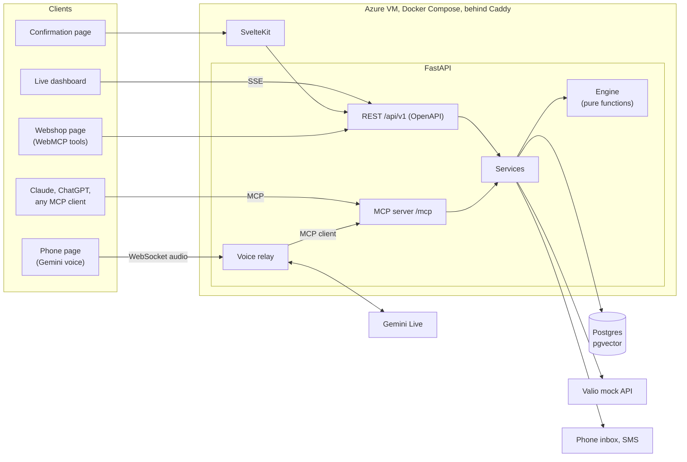

# S.I.MO: trusted ordering agents for Valio Aimo

Our entry to the Valio Aimo challenge at Junction 2026.

S.I.MO is a deterministic ordering engine behind one MCP server. Any buyer agent can use its ten tools to find products, turn a recipe (or a photo of one) into order lines and get a fixed-price quote. The agent does the talking. The engine makes every decision, with no LLM inside. There is no organisation model: a human confirms every order through a link sent to their phone, and anything unusual is pointed out first.

Three clients sit on top of the same tools, to show that no client is special:

- **Phone**: a call with S.I.MO in the browser, with live captions. The audio goes through our relay to Gemini Live. No real phone call is placed. This is the main stage demo.
- **Webshop**: our own page in the Aimo webshop's style, with the whole catalogue. It registers the tools through WebMCP, so a browser agent can order there (in the demo, Chrome with the MCP-B extension). It also has a S.I.MO chat panel, which can read a recipe photo.
- **Chat connector**: Claude, ChatGPT or any MCP client connects to the MCP server directly, after an OAuth login.

No agent tool can confirm an order. The only place to confirm is the page behind the link, which also has an "Ask for changes" chat. Every step goes into a hash-chained audit log and shows up live on the dashboard.

## Try it

The demo runs at **https://simo.mankeli.co**. The start page leads to the call, the webshop, the live dashboard and the connector setup.

No real order is ever placed. In the demo, the confirmation link lands in a simulated phone inbox on the call page. Real SMS sits behind a flag that is off by default.

## Status

Built on `main` so far:

- The shared contract: Pydantic models for the eight agent tools and the engine (`api/app/schemas/`).
- The engine pipeline: resolve, allergen and diet filter, availability and dates, units and rounding, ranking, substitution, price, sanity checks and the decision (`api/app/engine/`).
- The rules as data (`policy/`) and their loader.
- The catalogue tables, the loader for Valio's product file, and product search with full-text, trigram and name vectors.
- The Valio API adapter with its rate limit, cache and snapshot mode.
- Demo companies, accounts and their seeded order history.
- The MCP server and the REST API, the quote service, quote hashes and JWS signatures, and the hash-chained audit log.
- The confirmation request with the simulated phone inbox, the confirmation endpoints and the order record.
- The confirmation page `/c/[token]`. Screenshots are in `docs/screenshots/confirmation-page/`.
- The voice relay on Gemini Live, the S.I.MO system prompt, the start page, the call screen and the simulated phone.
- The public dashboard, its API and its live stream.
- The webshop page with the WebMCP tools.
- OAuth for the Claude and OpenAI connectors.
- The FastAPI app, Alembic migrations, Docker Compose, Caddy, Key Vault settings, CI and the deployment on the VM.
- The Gemini Live spike: Finnish recognition, latency, function calls and a real voice (`spikes/gemini-live/`).

Still open, and tracked in the issues: real SMS through Twilio, recipes beyond the two fixture recipes, product images, the webshop chat panel (stretch), the ChatGPT desktop browser check of the webshop, and the stage rehearsal.

## Architecture



- **Engine**: `decide(EngineInput) -> EngineOutput`. No database, HTTP, clock reads or randomness, so every decision can be replayed from the audit log.
- **Services**: gather the inputs, call the engine, store the quote, write the audit events and send the link.
- **Interfaces**: MCP tools and REST routes share one set of models, so the two cannot drift apart.

Hosting: one Azure VM runs Caddy, FastAPI and SvelteKit with Docker Compose, against Azure Database for PostgreSQL. Secrets come from Azure Key Vault. Laptops run Postgres in Docker instead. Details are in `technical-plan.md` §2 and §10.

## Run it locally

You need Docker. For work on one part, you also need Python 3.12 with `uv` (API) or Node 24 with `pnpm` (web).

```sh
cp .env.example .env
docker compose -f deploy/docker-compose.yml -f deploy/docker-compose.dev.yml up --build
```

This starts Caddy, the API, the web app and a local Postgres on http://localhost. Try http://localhost/api/v1/health. Compose runs the confirmation page against the API; for its fixture at http://localhost/c/fx-ready-try, start with `CONFIRMATION_SOURCE=fixture`.

The dev servers, tests, linters, migrations and the catalogue loader are in [`CLAUDE.md`](CLAUDE.md), section "Commands". The web app also has its own [`web/README.md`](web/README.md).

Never commit `.env` or any API key.

## Repository map

| Folder | What is in it |
|---|---|
| `api/` | FastAPI app (Python 3.12, `uv`): the engine, services, adapters, the shared contract in `app/schemas/`, database models, loaders, Alembic migrations and tests |
| `web/` | SvelteKit app: the start page, call screen and simulated phone, confirmation page, dashboard, webshop, and the connector login pages |
| `policy/` | The engine's rules as versioned data: allergen rules, policy values, message templates in Finnish and English, unit names |
| `data/` | Data files: Valio recipes and their product links, category names, allergen codes, the demo kitchens' order history, category substitutes and Valio snapshots. The product file is downloaded here and not committed |
| `deploy/` | Docker Compose files, the Caddyfile and the VM's non-secret settings |
| `docs/` | UI specs (`specs/`), the design export (`design/`), screenshots and issue plans |
| `spikes/` | Throwaway experiments, for now the Gemini Live spike and its results |
| `scripts/` | One-off tools: design export, recipe-to-product mapping, an availability date check, the webshop's product pick, hand-out accounts, the audit chain check and a voice smoke test |

## Read more

- [`vision.md`](vision.md): what we build and why. The source of truth.
- [`technical-plan.md`](technical-plan.md): how we build it: architecture, build-or-buy choices, endpoints, hosting and milestones.
- [`docs/specs/`](docs/specs/README.md): what each demo screen does (call screen, confirmation page, dashboard, webshop chat).
- [`docs/design/`](docs/design/README.md): how the screens look, with exported screens and the link to the design canvas.
- [`valio-api-analysis.md`](valio-api-analysis.md): findings about the Valio mock API and its data.
- [GitHub issues](https://github.com/Mankeli-Software/junction-2026/issues): the work, with the overview, owners and order of work in [#63](https://github.com/Mankeli-Software/junction-2026/issues/63). Issues #1 to #21 describe an earlier model and are superseded.
- [`CLAUDE.md`](CLAUDE.md): how the team works: workflow, ownership, commands and the Valio API rules.
