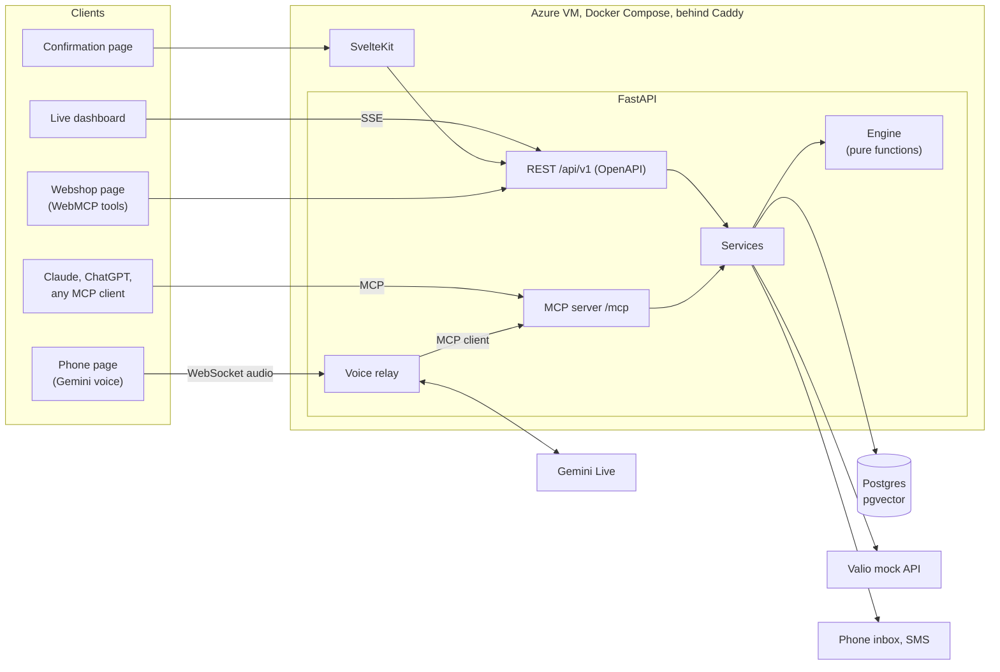

# S.I.MO: trusted ordering agents for Valio Aimo

Our entry to the Valio Aimo challenge at Junction 2026.

S.I.MO is a deterministic ordering engine behind one MCP server. Any buyer agent can use it to find products, turn a recipe into order lines and get a fixed-price quote. The agent does the talking. The engine makes every decision, with no LLM inside. A human confirms every order through a link sent to their phone, and anything unusual is pointed out first.

Three clients sit on top of the same tools, to show that no client is special:

- **Phone**: a call with S.I.MO in the browser, on Gemini Live voice, with live captions. This is the main stage demo.
- **Webshop**: a copy of the Aimo webshop page that registers the tools through WebMCP, so a browser agent can order there.
- **Chat connector**: Claude, ChatGPT or any MCP client connects to the MCP server directly.

No agent tool can confirm an order. The only place to confirm is the page behind the link. Every step goes into a hash-chained audit log and shows up live on a public dashboard.

## Try it

The demo runs at **https://simo.mankeli.co**. It is being deployed: today it shows a placeholder page and the API health check (`/api/v1/health`). The demo screens appear there as they are released.

No real order is ever placed. In the demo, the confirmation link lands in a simulated phone inbox on the call page. Real SMS sits behind a flag that is off by default.

## Status

Built on `main` so far:

- The shared contract: Pydantic models for the seven agent tools and the engine, with a stub engine that returns a fixed quote (`api/app/schemas/`, `api/app/engine/`).
- The rules as data (`policy/`) and their loader.
- The catalogue tables and the loader for Valio's product file.
- The FastAPI app with a health endpoint, Alembic migrations, Docker Compose, Caddy, Key Vault settings and CI.
- The confirmation page `/c/[token]`, running against an in-memory fixture until its backend lands. Screenshots are in `docs/screenshots/confirmation-page/`.
- The Gemini Live spike: Finnish recognition, latency and function calls (`spikes/gemini-live/`).

Planned, and tracked in the issues: the engine pipeline, product search, the Valio API adapter, the MCP server and REST API, the audit log, the confirmation backend, the voice relay and call screen, the dashboard, the WebMCP webshop and the chat connectors.

## Architecture



- **Engine**: `decide(EngineInput) -> EngineOutput`. No database, HTTP, clock reads or randomness, so every decision can be replayed from the audit log.
- **Services**: gather the inputs, call the engine, store the quote, write the audit events and send the link.
- **Interfaces**: MCP tools and REST routes share one set of models, so the two cannot drift apart.

Hosting: one Azure VM runs Caddy, FastAPI and SvelteKit with Docker Compose, against Azure Database for PostgreSQL. Secrets come from Azure Key Vault. Laptops run Postgres in Docker instead. Details are in `technical-plan.md` §2 and §10.

## Run it locally

You need Docker. For work on one part, you also need Python 3.12 with `uv` (API) or Node 24 with `pnpm` (web).

```sh
cp .env.example .env
docker compose -f deploy/docker-compose.yml -f deploy/docker-compose.dev.yml up --build
```

This starts Caddy, the API, the web app and a local Postgres on http://localhost. Try http://localhost/api/v1/health and the confirmation page fixture at http://localhost/c/fx-ready-try.

The dev servers, tests, linters, migrations and the catalogue loader are in [`CLAUDE.md`](CLAUDE.md), section "Commands". The web app also has its own [`web/README.md`](web/README.md).

Never commit `.env` or any API key.

## Repository map

| Folder | What is in it |
|---|---|
| `api/` | FastAPI app (Python 3.12, `uv`): the engine, services, adapters, the shared contract in `app/schemas/`, database models, loaders, Alembic migrations and tests |
| `web/` | SvelteKit app: the confirmation page now, later the start page, call screen, dashboard and webshop |
| `policy/` | The engine's rules as versioned data: allergen rules, policy values, message templates in Finnish and English, unit names |
| `data/` | Data files: Valio recipes and their product links, category names, allergen codes. The product file is downloaded here and not committed |
| `deploy/` | Docker Compose files, the Caddyfile and the VM's non-secret settings |
| `docs/` | UI specs (`specs/`), the design export (`design/`), screenshots and issue plans |
| `spikes/` | Throwaway experiments, for now the Gemini Live spike and its results |
| `scripts/` | One-off tools: design export, recipe-to-product mapping, an availability date check |

## Read more

- [`vision.md`](vision.md): what we build and why. The source of truth.
- [`technical-plan.md`](technical-plan.md): how we build it: architecture, build-or-buy choices, endpoints, hosting and milestones.
- [`docs/specs/`](docs/specs/README.md): what each demo screen does (call screen, confirmation page, dashboard, webshop chat).
- [`docs/design/`](docs/design/README.md): how the screens look, with exported screens and the link to the design canvas.
- [`valio-api-analysis.md`](valio-api-analysis.md): findings about the Valio mock API and its data.
- [GitHub issues](https://github.com/Mankeli-Software/junction-2026/issues): the work, with the overview, owners and order of work in [#63](https://github.com/Mankeli-Software/junction-2026/issues/63). Issues #1 to #21 describe an earlier model and are superseded.
- [`CLAUDE.md`](CLAUDE.md): how the team works: workflow, ownership, commands and the Valio API rules.
