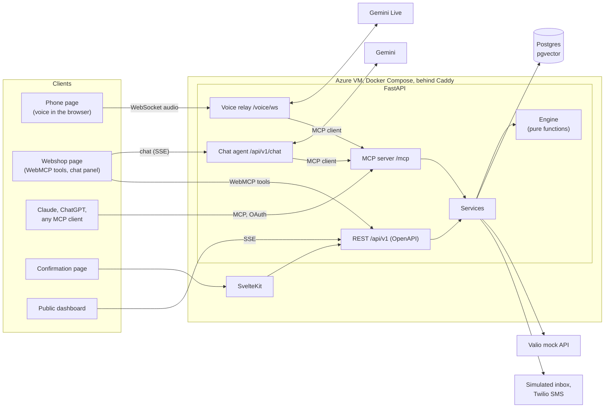

# S.I.MO: trusted ordering agents for Valio Aimo

Our entry to the Valio Aimo challenge at Junction 2026.

S.I.MO is a deterministic ordering engine behind one MCP server. Any buyer agent can use its ten tools to find products, turn a recipe (or a photo of one) into order lines and get a fixed-price quote. The agent does the talking. The engine makes every decision, with no LLM inside. There is no organisation model: a human confirms every order through a link sent to their phone, and anything unusual is pointed out first.

Three clients sit on top of the same tools, to show that no client is special:

- **Phone**: a call with S.I.MO in the browser, with live captions. The audio goes through our relay to Gemini Live. No real phone call is placed. This is the main stage demo.
- **Webshop**: our own page in the Aimo webshop's style, with every category of the catalogue. It registers the tools through WebMCP, so a browser agent can order there (in the demo, Chrome with the MCP-B extension). It also has a S.I.MO chat panel, which can read a recipe photo.
- **Chat connector**: Claude, ChatGPT or any MCP client connects to the MCP server directly, after an OAuth login.

No agent tool can confirm an order. The only place to confirm is the page behind the link, which also has an "Ask for changes" chat. Every step goes into a hash-chained audit log and shows up live on the dashboard.

## Try it

The demo runs at **https://simo.mankeli.co**. The start page leads to the call, the webshop, the live dashboard and the connector setup. The MCP server is at `/mcp` and the REST API's docs are at `/api/v1/docs`.

- **Your number makes your company.** Typing a phone number creates a demo company for it. It is one of seven kitchen types (pizza restaurant, school kitchen, lunch restaurant, bar, vegan catering company, cafe or tech office), picked from the number, with eight weeks of seeded order history. The same number always gets the same company (`vision.md` §13).
- **The link goes to your simulated phone.** Every confirmation link lands in the simulated phone inbox on the call page, which is private to the browser that typed the number. On production, real SMS through Twilio also goes out, but only to numbers on an allowlist (`SMS_TWILIO_ENABLED` and `SMS_ALLOWLIST`).
- **The dashboard is public.** Anyone with the URL sees every order, step and conversation, with no login. Phone numbers and emails only show masked (`+358 40 *** **12`). The confirmation token and link, and the simulated inbox, are never public.

No real order is ever placed.

## What we have built:

- The shared contract: Pydantic models for the ten agent tools and the engine (`api/app/schemas/`).
- The engine pipeline: resolve, allergen and diet filter (with one-off exclusions for a single order), availability and dates, units and rounding, ranking, substitution, price, sanity checks and the decision (`api/app/engine/`).
- The rules as data (`policy/`) and their loader.
- The catalogue tables, the loader for Valio's product file, product images, and product search with full-text, trigram and name vectors.
- All of Valio's recipes, searchable with full-text, trigram and vector search, scaled to the portions asked. Ingredients linked to a catalogue product are ordered; the rest are listed as not ordered.
- Recipe photos: the AI reads a photo into a recipe draft, the buyer checks and confirms it, and only then is it quoted (`propose_recipe`, `confirm_recipe`). Not on the phone.
- The Valio API adapter with its rate limit, cache and snapshot mode.
- Demo companies of seven kitchen types, accounts and their seeded order history.
- The MCP server and the REST API, the quote service, quote hashes and JWS signatures, and the hash-chained audit log.
- The confirmation request with the simulated phone inbox and real SMS through Twilio for allowlisted numbers, the confirmation endpoints and the order record.
- The confirmation page `/c/[token]`, with its "Ask for changes" chat.
- The voice relay on Gemini Live, the S.I.MO system prompt, the start page, the call screen and the simulated phone.
- The public dashboard, its API and its live stream.
- The webshop with every catalogue category (up to 20 products each), the WebMCP tools and the S.I.MO chat panel (Gemini, with A2UI cards).
- OAuth for the Claude and OpenAI connectors.
- The FastAPI app, Alembic migrations, Docker Compose, Caddy, Key Vault settings, CI, Application Insights tracing and the deployment on the VM.
- The Gemini Live spike: Finnish recognition, latency, function calls, a real voice and language switches (`spikes/gemini-live/`).

Still open: recipe orders by phone that lose lines or skip ingredients, a few search and quantity bugs, the webshop chat's check against a live Gemini model, testing on real phones, and the stage rehearsal. The [open issues](https://github.com/Mankeli-Software/junction-2026/issues) have the details.

## Architecture

- **Engine**: `decide(EngineInput) -> EngineOutput`. No database, HTTP, clock reads or randomness, so every decision can be replayed from the audit log.
- **Services**: gather the inputs, call the engine, store the quote, write the audit events and send the link.
- **Interfaces**: MCP tools and their REST twins share one set of models, so the two cannot drift apart. The voice relay and the chat agent are MCP clients of our own server, like any outside agent.

Hosting: one Azure VM runs Caddy, FastAPI and SvelteKit with Docker Compose, against Azure Database for PostgreSQL.

## Repository map

| Folder | What is in it |
|---|---|
| `api/` | FastAPI app (Python 3.12, `uv`): the engine, services, adapters, the shared contract in `app/schemas/`, database models, loaders, Alembic migrations and tests |
| `web/` | SvelteKit app: the start page, call screen and simulated phone, confirmation page, dashboard, webshop with its chat panel, and the connector login pages |
| `policy/` | The engine's rules as versioned data: allergen rules, policy values, message templates in Finnish and English, unit names |
| `data/` | Data files: Valio recipes, their product links and their committed vectors, product image URLs, category names, the webshop's section names, allergen codes, the demo kitchens' order history, category substitutes and Valio snapshots. The product file is downloaded here and not committed |
| `deploy/` | Docker Compose files, the Caddyfile and the VM's non-secret settings |
| `docs/` | UI specs (`specs/`), the design export (`design/`), screenshots, issue plans (`plans/`) and the audit chain format |
| `spikes/` | Throwaway experiments, for now the Gemini Live spike and its results |
| `scripts/` | One-off tools: design export, recipe-to-product mapping, the product image crawl, an availability date check, the webshop's product pick, hand-out accounts, the audit chain check, and voice and chat smoke tests |
