# Demo UI design

The visual design for the demo screens. It follows the specs in [`docs/specs`](../specs/README.md), which say what each screen does; this folder shows how it looks.

- **Design canvas (source of truth for the look):** https://claude.ai/artifact/Je1fmCEnZv6FDFT4QYmMZ3 . Comment there to change a screen.
- **Exported screens:** [`screens/`](screens/) (PNG), [`html/`](html/) (standalone pages that open in any browser and link to each other), [`source/`](source/) (the canvas artboard files).
- **Re-export after a canvas change:** download the canvas files (`project/canvas.json` and `project/*.dc.html`) into a folder, then run `python3 scripts/export_design_screens.py <that folder>`.

The export in this folder has the "DEMO" labels removed (decided 2026-11-14). That change is not yet published to the canvas, so the canvas still shows them.

## Style

Taken from the current Aimo webshop so the demo feels at home next to it, without copying its logo or wordmark.

| Element | Rule |
|---|---|
| Frame | Dark petrol top bar `#1E4F68`, pale lavender header band `#EEE9F5`, light grey-blue page `#F3F6F8`, white cards with a thin border `#DCE3E8` |
| Type | Condensed bold headings (Barlow Condensed), rounded sans body (Figtree) |
| Colour roles | Lime `#C6E02A` for the one main action only (Confirm, Start). Yellow `#FFE14D` for notices and tags. Green for confirmed, amber for waiting, red for needs attention, always with a word, never colour alone |
| Prices | Big and bold, unit small after it, VAT included and labelled once |
| Mobile | No walls of text: one idea per card, one bold line and one short line, details behind a tap |
| Text rules | No middle-dot character anywhere. Masked numbers use stars: `+358 40 *** **12`. No "DEMO" labels; notices that no real order is placed stay |
| Agent | Always written **S.I.MO**. Speaks warmly ("Tell me what your kitchen needs. I will sort it out."), not presented on screen as an "AI agent"; it says it is an AI helper in its greeting |
| Icons | Inline stroke icons. Small actions are icon buttons (info for Why, pencil for change) |

## Flows

### 0. Demo start

Where every visitor lands. Lists what you can try. On a phone, calling S.I.MO comes first and the dashboard is last, marked "Best on a computer", because the dashboard is not optimised for phones.

| Screen | What it shows |
|---|---|
| [`00-start-computer`](screens/00-start-computer.png) | Hero, three options (Call S.I.MO with QR code and "Call from this computer", Watch the dashboard, Chat in the webshop), "Bring your own agent" with the MCP server address and how to connect Claude, ChatGPT/OpenAI (WebMCP), any MCP client and the OpenAPI docs, "How it works" in four steps |
| [`01-start-phone`](screens/01-start-phone.png) | The same options as a short list: Call S.I.MO, Webshop chat, Use your own agent, then the dashboard |

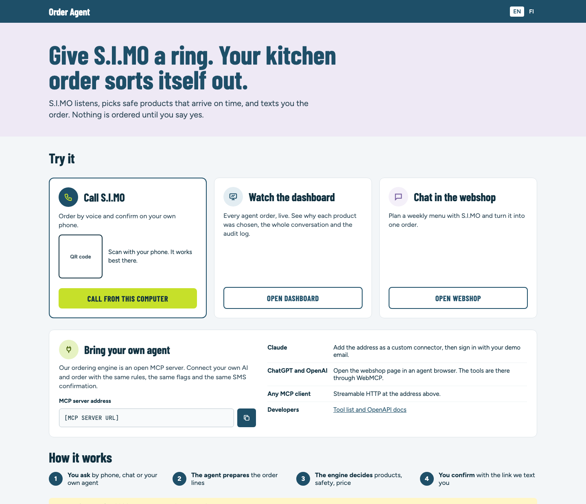 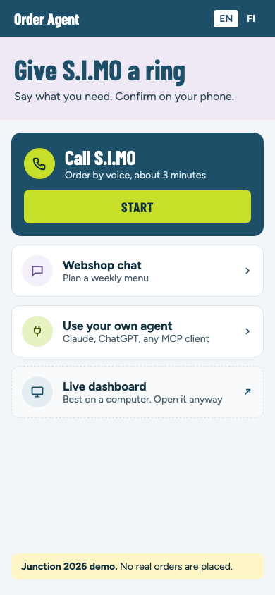

### 1. Phone call with S.I.MO

Spec: [`call-screen.md`](../specs/call-screen.md). The visitor's own phone becomes a demo phone, so it is clear they are not making a real call. On a computer the same screens show at phone size inside a phone frame.

Flow: set up → contact S.I.MO → call → call ended → notification opens the confirmation page.

| Screen | What it shows |
|---|---|
| [`10-call-setup`](screens/10-call-setup.png) | Phone number, kitchen exclusions as chips, one notice about the dashboard, "Open demo phone" |
| [`11-call-contact`](screens/11-call-contact.png) | Phone-app Contacts with the S.I.MO card and a green Call button, "Try saying" examples, kitchen and usual order, bottom tab bar |
| [`12-call-in-call`](screens/12-call-in-call.png) | S.I.MO, call timer, speaking indicator, live captions for both sides, Mute, Speaker, Captions, red hang-up |
| [`13-call-ended`](screens/13-call-ended.png) | Notification from S.I.MO "Confirm your order, 128,40 €", "Nothing is ordered yet" in three steps, SMS note, Call again |
| [`14-call-on-computer`](screens/14-call-on-computer.png) | The phone flow inside a phone frame on a computer, with a QR code to move to your own phone |

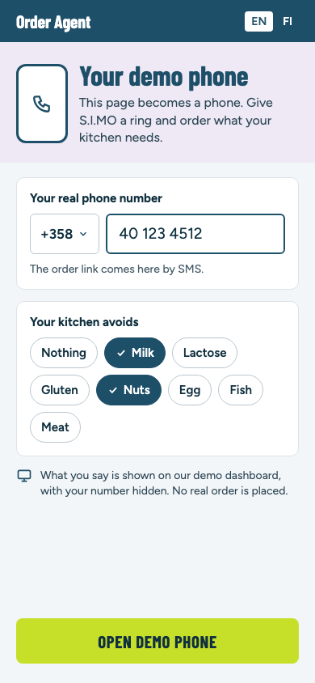 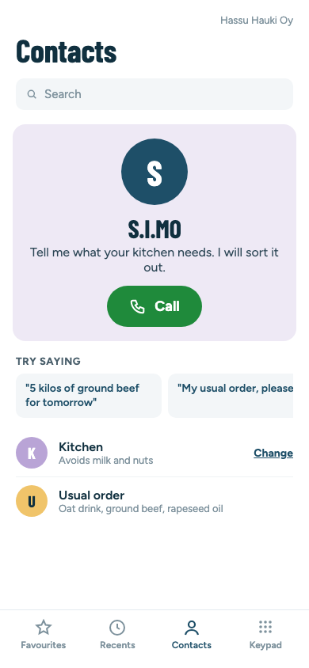 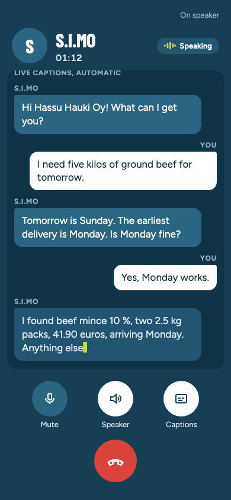 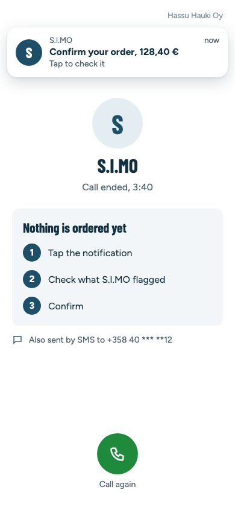

### 2. Confirmation page

Spec: [`confirmation-page.md`](../specs/confirmation-page.md). Opened from the SMS or the call-screen notification. The only place an order can be confirmed.

Flow: check flags → (optional) open a line to see why and change it → Confirm → order received.

| Screen | What it shows |
|---|---|
| [`20-confirm-check`](screens/20-confirm-check.png) | Header with delivery date and total, "Check these first" with each flag (acknowledged, choice between rounding and exact fit, Got it), "You asked, we added" per line with Why and change buttons, Confirm disabled until all flags are checked |
| [`21-confirm-line`](screens/21-confirm-line.png) | Sheet for one line: why this product (found, removed by reason, left), other options, amount stepper, remove |
| [`22-confirm-received`](screens/22-confirm-received.png) | Order received with order number, lines, total, "You checked 3 flagged items", no-real-order notice |

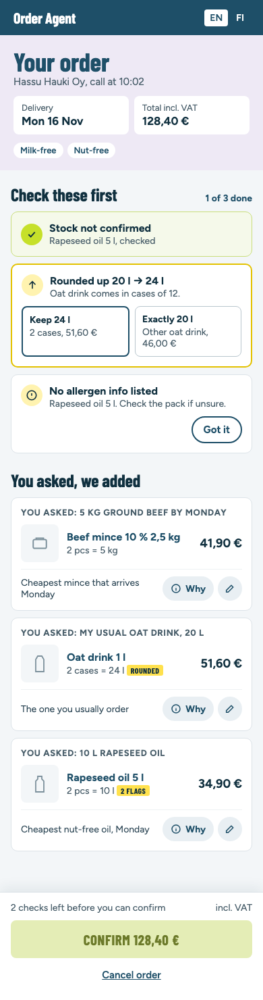 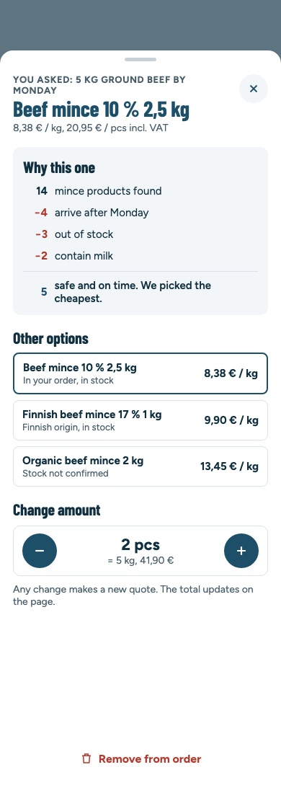 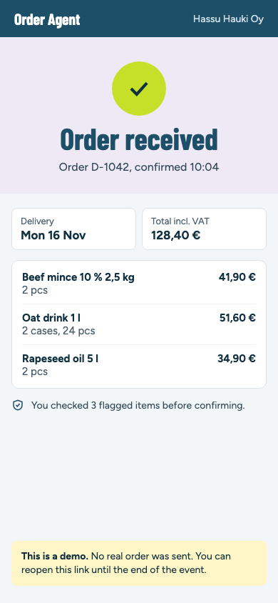

### 3. Live dashboard

Spec: [`dashboard.md`](../specs/dashboard.md). Open, read-only, for every agent order from every channel. Built for a computer or a big screen.

Flow: overview → order summary → full flow → audit log.

| Screen | What it shows |
|---|---|
| [`30-dashboard-overview`](screens/30-dashboard-overview.png) | Counters, orders by channel (Phone, Webshop chat, WebMCP, MCP connectors), status filters, order cards grouped by company with a channel badge |
| [`31-dashboard-summary`](screens/31-dashboard-summary.png) | One order: what was asked next to what was added, the "why" drill-down (filter counts and ranked candidates), flags the buyer checked, trust panel (signature, audit chain) |
| [`32-dashboard-full-flow`](screens/32-dashboard-full-flow.png) | Timeline of buyer and agent turns, tool calls with arguments and responses, engine steps and confirmation, with a filter |
| [`33-dashboard-audit-log`](screens/33-dashboard-audit-log.png) | Chain check, Verify again, Download JSON, event list and the full record of one event |

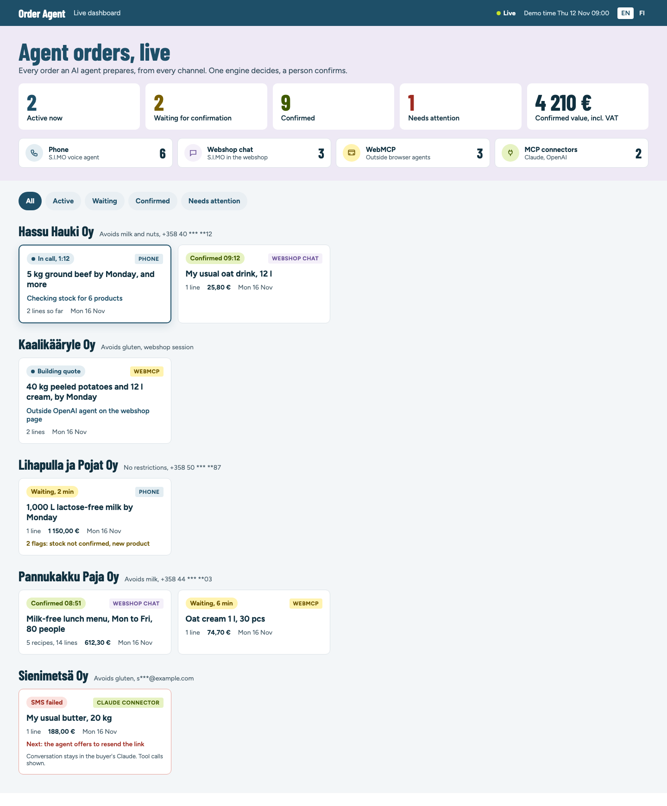 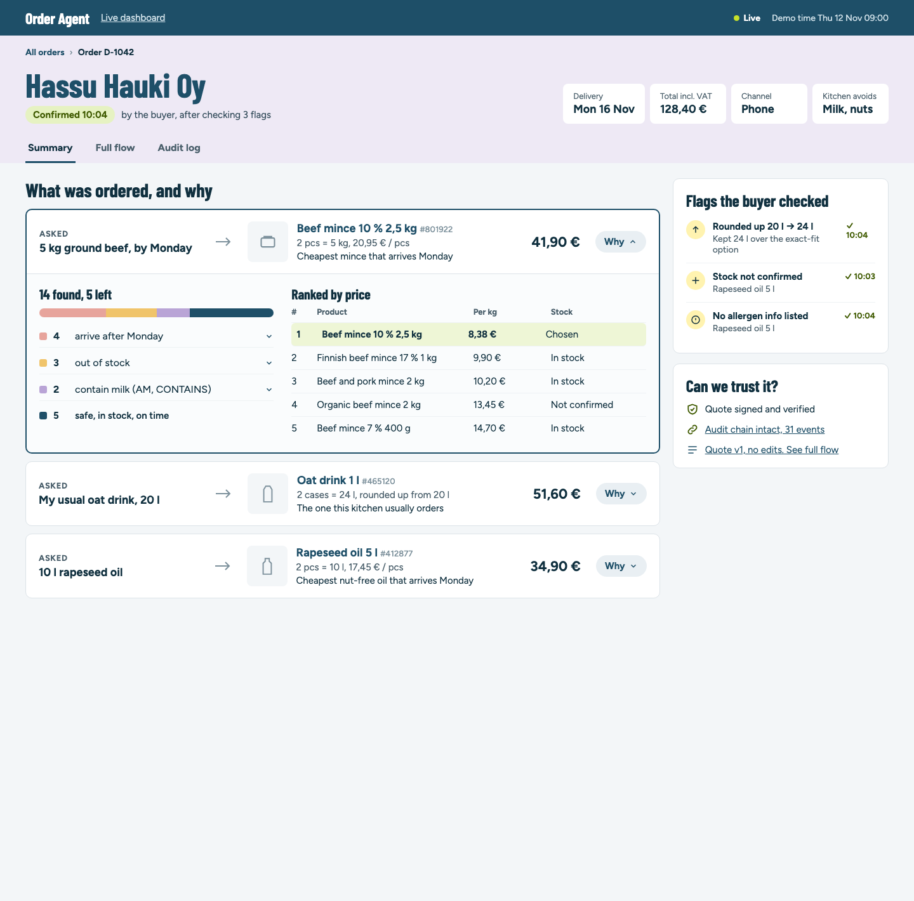

### 4. Webshop chat (stretch)

Spec: [`webshop-chat.md`](../specs/webshop-chat.md). S.I.MO in a panel on top of the scraped webshop page.

Flow: ask for a weekly menu → swap a day → build order → send to phone → confirmation page.

| Screen | What it shows |
|---|---|
| [`40-webshop-desktop`](screens/40-webshop-desktop.png) | Chat panel beside the static webshop page, current order bar, weekly menu card with swap buttons, example prompts |
| [`41-webshop-menu`](screens/41-webshop-menu.png) | Phone: the week as five day buttons and a recipe card to swap in |
| [`42-webshop-quote`](screens/42-webshop-quote.png) | Phone: quote grouped by day, "Not ordered" ingredients, flag count, Send to my phone, link to the confirmation page |

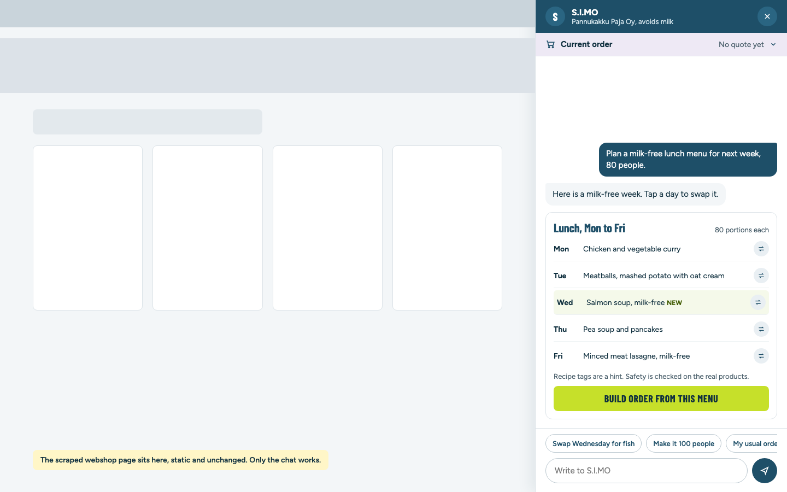 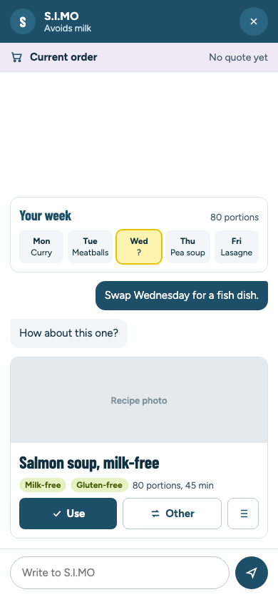 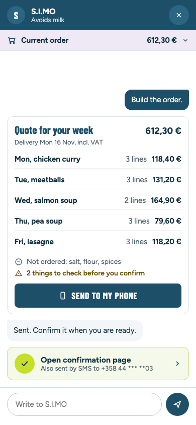

## Decided after the export, not yet in the screens

These decisions came after the screens were drawn (`technical-plan.md` §9.8, 2026-11-14). The specs in [`docs/specs`](../specs/README.md) already follow them. The screens are not re-exported, so where a screen and this list disagree, this list and the specs win.

- **Dashboard access: everything public, no login** (changed 2026-11-14, `technical-plan.md` §9.5). The screens already match: transcripts, tool calls, payloads and masked numbers are shown without a login. An earlier decision made them private; that was reversed, so `30` to `33` need no change. `10-call-setup`'s notice should say that what you say is shown on the public dashboard.
- **The link goes to the simulated phone inbox.** Every confirmation message lands in the demo phone's inbox. Twilio sends a real SMS only when the feature flag is on and the number is on the allowlist, and the "also sent by SMS" line shows only when one went out. Affects `00-start-computer` ("the link we text you"), `10-call-setup` ("The order link comes here by SMS" and the notice that what you say is shown on the dashboard), `13-call-ended` (the SMS line is shown every time) and `14-call-on-computer` ("still goes to the number you typed"). The confirmation page is opened from the inbox message, not from an SMS.
- **No confirmation link in the webshop chat.** The inbox shows on the phone page only, never in the shop, because a browser agent works inside the shop page. Webshop visitors read the link on the phone page in the same browser. Affects `42-webshop-quote`: drop the "Open confirmation page" button and the "link to the confirmation page" in the table below.

## Decided in the design review, not yet in the specs

- The agent is called **S.I.MO** everywhere, with a warm voice, not labelled on screen as an AI agent. It tells callers it is an AI helper in its greeting.
- The call flow looks like a phone app: set up, Contacts with S.I.MO, call, call ended. On a computer it shows at phone size in a frame, with a QR code.
- A new **demo start page**, for computer and phone, listing the ways to try the demo and how to connect your own agent over MCP.
- The dashboard shows orders from every channel, with counts per channel. It is not optimised for phones; the phone start page puts it last.
- No middle-dot character, masked numbers with stars, no "DEMO" labels.
- Line actions on the confirmation page are icon buttons (Why, change).

## Mock data in the screens

All companies, numbers and prices in the screens are invented for the design, and the totals add up. Real figures come from the engine.
