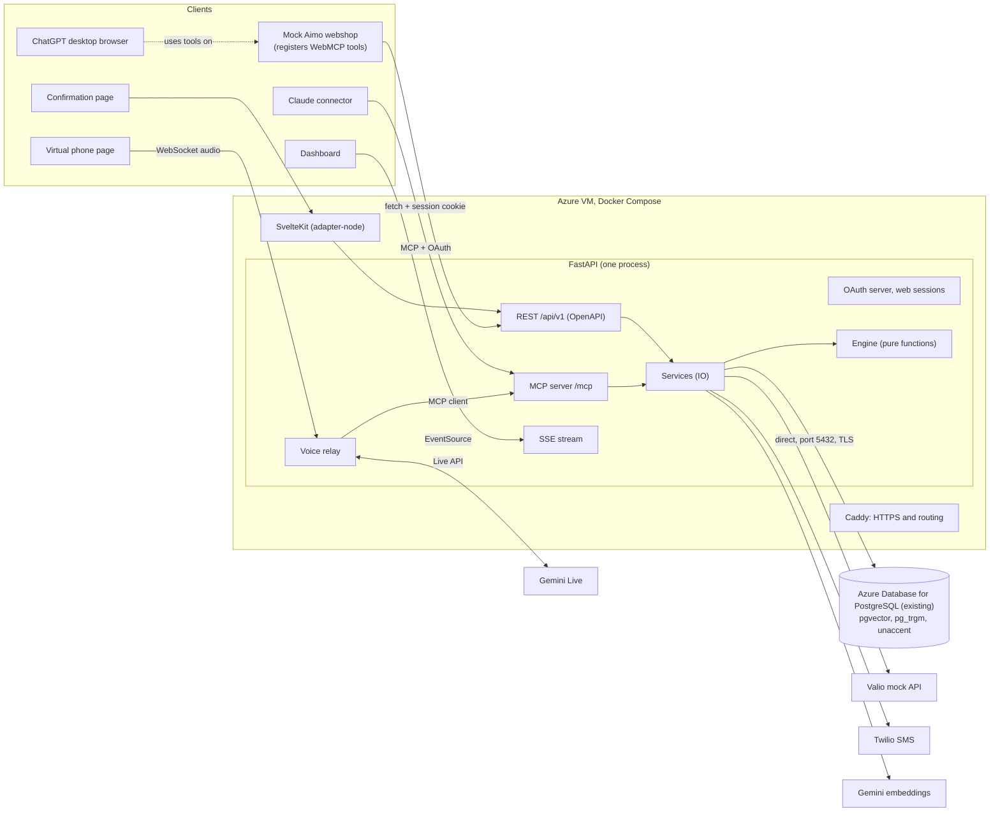
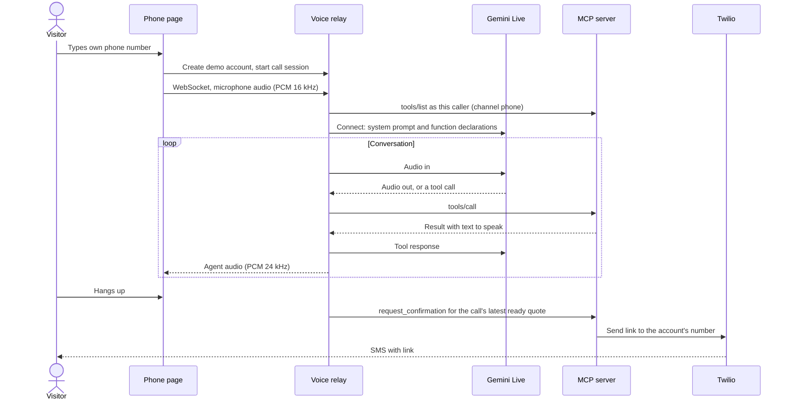

# Technical implementation plan

Status: draft v2, 2026-11-14, after the first PR review. Built on `vision.md` (source of truth), `valio-api-analysis.md`, the files in `data/` and the team answers recorded in section 1. **The existing GitHub issues (#1 to #21) are not a source for this plan.** New issues will be created from this spec and should reference it. Where the plan suggests something vision.md does not settle, it is marked *proposed*. Section 13 lists what still needs a team answer.

## 1. Decisions this plan builds on

Taken on 2026-11-14, in addition to vision.md:

| Topic | Decision |
|---|---|
| Backend | Python, FastAPI |
| Frontend | SvelteKit |
| Cloud | Azure (we have credits). The app containers (Caddy, FastAPI, SvelteKit) run on one VM with Docker Compose. Not Container Apps or Web Apps, because their 240-second request limit may cut voice calls and the dashboard stream (section 9) |
| Database | The existing Azure Database for PostgreSQL instance, for the demo and for development. Nobody runs Postgres in Docker. `vector`, `pg_trgm` and `unaccent` are allowed on the server (section 9.1) |
| Voice path | Our server relays audio between the browser and Gemini Live. The server is an ordinary MCP client |
| SMS | Twilio |
| Product images | The image file's `code` is the product file's `id`. Images are hotlinked from their `img` URL |
| Connector login | Our own OAuth 2.1 authorization server, built on the MCP Python SDK's auth routes, with our own email and password page |
| Recipe embeddings | Gemini embeddings, stored in pgvector |
| Clock | A business clock frozen at Thu 2026-11-12 09:00 for cutoffs and delivery dates. The real clock for link and quote expiry, the duplicate check and audit timestamps |
| SMS after a call | When the call ends, the voice relay calls `request_confirmation` for the call's latest ready quote |

Constraints from vision.md that shape the architecture:

- Deterministic engine, no LLM inside. Same input and policy version give the same decision and quote hash (§3).
- No agent tool can confirm. The only place to confirm is the page behind the SMS link (§3, §6, §8).
- One MCP server over Streamable HTTP, with the same operations documented as OpenAPI (§8).
- Product search runs locally on the product file loaded into Postgres. Price and availability are fetched only for a shortlist and cached for about five minutes. A 429 means wait 30 seconds (§10).
- Injectable clock, demo clock Thu 2026-11-12 09:00, `closingTime` enforced (§10). This overrides section 12 of `valio-api-analysis.md`.
- Live API or recorded snapshot, behind a switch (§10).
- Gross prices in integer cents, decimal arithmetic, deposits not added (§10).
- Hash-chained append-only audit, dashboard updated by push (§11).
- Quotes signed as JWS with a published key (§12).

## 2. Architecture



Three layers inside FastAPI:

1. **Interfaces**: MCP tools, REST routes, the voice relay, the Twilio webhook, OAuth and the SSE stream. They parse, authenticate and call a service. No business logic.
2. **Services**: gather the inputs (products and history from Postgres, price and availability from the Valio adapter, the kitchen profile, the clock), call the engine, store the quote, write audit and status events, send SMS.
3. **Engine**: `decide(EngineInput) -> EngineOutput`. No database, no HTTP, no clock reads, no randomness. Everything it uses is in its input.

Because the engine is pure and the full `EngineInput` is stored in the audit event, any decision can be replayed. That makes the determinism principle a test (section 10), not a promise.

REST and MCP share one set of Pydantic models and one service layer. FastAPI turns the models into the OpenAPI document. The MCP tools use the same models for their input schemas, so the two surfaces cannot drift apart.

## 3. Build or use out of the box

| Component | Use out of the box | We build | Priority (vision §13) |
|---|---|---|---|
| HTTP API and OpenAPI | FastAPI generates OpenAPI 3.1 from Pydantic v2 models. `extra="forbid"` rejects unknown fields (vision §8) | Routes under `/api/v1`, request and response models | P0 |
| MCP server | MCP Python SDK (`FastMCP`), Streamable HTTP, mounted into FastAPI at `/mcp`. MCP Inspector for manual testing | The seven tools of vision §8 as thin wrappers over services. Tool descriptions written for a voice agent | P0 |
| Ordering engine | Python `decimal`, `zoneinfo` | All of it: resolve, allergen and diet filter, units, availability and dates, ranking, substitution, price, sanity checks, decision, explanation text | P0 (sanity checks, tuned ranking and exact-fit are P1) |
| Rules and texts | YAML and CSV loaders | Versioned rule files, reason-code templates in Finnish and English, a name table for unit codes (`KI`, `ST`, `PAK`, ...) | P0 |
| Product search | Postgres full-text search (`finnish` and `english` configs), `pg_trgm` for typos, `unaccent` | Loader for the product file, search SQL, a short synonym list, deterministic ranking | P0 |
| Recipe search | pgvector (HNSW index), Gemini embeddings, Postgres full-text search | Embedding script, hybrid query, scaling to portions | P1 |
| Valio API client | `httpx` (async) | Rate limiter, 429 back-off, 5-minute cache, snapshot record and replay, sales-unit cross-check | P0 |
| Quote hash and signature | `rfc8785` (canonical JSON), `joserfc` (JWS with EdDSA), `cryptography` | Quote model, hash, JWKS endpoint | P0 |
| Confirmation token | `secrets.token_urlsafe(32)` (256 bits), SHA-256 | Token table, single-use and expiry rules | P0 |
| SMS | Twilio Messages API, `twilio` SDK, delivery status callbacks | SMS service with a fake inbox for development, message text, status webhook | P0 |
| Confirmation page | SvelteKit server rendering, Svelte's default escaping | Odd things first with acknowledgements, asked-and-added lines, edit and re-quote, confirm, cancel, "order received" | P0 |
| Voice agent | Gemini Live API (`google-genai` SDK, function calling), browser `getUserMedia` and `AudioWorklet` | Audio relay, MCP-to-Gemini tool bridge, system prompt, call screen, demo account on number entry, SMS after hang-up | P0 |
| Webshop with WebMCP | The `modelContext` API in the ChatGPT desktop app's browser. The MCP-B polyfill or Chrome's testing flag for ordinary Chrome | Mock Aimo shop (login, search, product cards, cart) and tool registration calling `/api/v1` | P0 |
| Claude connector | Claude custom connectors (remote MCP URL plus OAuth). MCP Python SDK auth routes (metadata, client registration, authorize, token, PKCE). `argon2-cffi` for password hashes | Users table, the SDK's authorization-server provider backed by Postgres, login and sign-up pages | P1 |
| OpenAI connector | ChatGPT custom MCP connectors | Testing only | P1 |
| Live dashboard | Server-Sent Events (`sse-starlette`), Postgres `LISTEN/NOTIFY`. The listener needs a direct connection on port 5432, because PgBouncer in transaction mode drops notifications | Status events, plain-language step texts, operator and buyer views | P0 |
| Audit trail | Postgres, SHA-256 | Append-only hash-chained table, database privileges, chain checker | P0 |
| Database | The existing Azure Database for PostgreSQL instance, with `vector`, `pg_trgm` and `unaccent` allowed in `azure.extensions` (done 2026-11-14). SQLAlchemy 2, Alembic | Schema, migrations (the first one runs `CREATE EXTENSION` in each database), loaders, seed data | P0 |
| Hosting | Azure VM, Docker Compose, Caddy (automatic HTTPS) | Compose file for the app containers, Caddyfile, deploy script | P0 |

In short: protocols, transport, crypto, search primitives, speech and SMS come off the shelf. The engine, the data loaders, the confirmation flow, the relay and the four web pages are ours.

## 4. Engine

### 4.1 Contracts (proposed)

Input to `build_quote`, one call with all lines (vision §8). The agent sends structured lines and the engine never sees raw speech (vision §5):

```python
class LineRequest(BaseModel, extra="forbid"):
    line_id: str
    product_id: str | None = None   # when the agent already knows the product
    usual: bool = False             # "my usual butter"
    text: str | None = None         # product words only, e.g. "maito" or "milk"
    claims: list[Claim] = []        # lactose_free, gluten_free, vegan, ...
    category: str | None = None     # category code from data/valio_category_names.csv
    quantity: Decimal
    unit: RequestedUnit             # litre, kg, piece, sales unit, or a packaging word
    needed_by: date
    recipe_ref: RecipeRef | None = None
```

`EngineInput` = the lines, the kitchen profile (allergen and diet exclusions), a history summary, the candidate product records, one offer per candidate (price and availability, with fetch time and source live or snapshot), the rule set with its version, business "now" and the quote issue time.

`EngineOutput` = a decision (`ready`, `needs_clarification` or `rejected`), priced lines (asked, chosen, quantity in sales units and in the asked unit, gross unit price and line total in cents, delivery date, reason codes, trace), flags (code, whether the buyer must acknowledge it, Finnish and English text), alternatives, at most one clarification question, a next step for every rejection, text to speak in Finnish and English, and the quote when the decision is `ready`.

### 4.2 Pipeline per line

| Step | Rule | Source |
|---|---|---|
| Validate | Strict schema, limits on line count, string length and quantity | vision §8 |
| Resolve | A named product id must exist (otherwise stop). "My usual" comes from history. Otherwise run local search. Ambiguous matches go to the buyer | vision §3, §6 |
| Allergen and diet filter | A listed `CONTAINS` or `MAY_CONTAIN` for an excluded code blocks. No listing or `UNDECLARED`: orderable, flagged once per order. `X99` never blocks. Milk-free is decided on `AM`, lactose-free on `ML` plus the `LACTOSE` claim, nut-free on `AN` plus the specific nuts, gluten-free on the `GLUTEN` claim together with `AW`. Codes come from `data/gs1_allergen_codes.csv`. The same filter runs on every substitute. A conflict is a hard stop | vision §6, §10; analysis §11, §13 |
| Availability and date | Schedule line exists, amount above 0, `salesBlock` false at both levels, `availableDate` on or before needed-by, business "now" before `closingTime`. 999999 or more: orderable, flagged as unverified. Empty schedule: not available | vision §10 |
| Units | Sales unit comes from availability, checked against `units[]` and the price ratio. Disagreement is `UNIT_UNKNOWN`, a hard stop. Conversion uses `unitConversions`. A pack size read from the name is allowed and flagged. An unknown conversion, or a packaging word that could mean two sizes, goes to the buyer | vision §6, §10 |
| Rounding | Whole sales units (`allowedLotSize` 0.01 counts as 1). Rounding up is automatic when the overage is at most one unit and 2%, and is flagged. Above that, the buyer gets an exact-fit product as the alternative | vision §6, §10 |
| Rank | Price, stock certainty, history, origin. Ties broken by product id (*proposed*, keeps ranking deterministic) | vision §6 |
| Substitute | Only when the line cannot be filled. Order of tries: same product in another pack, then a curated `substitutions[]` pair, then a similar product, then a callback request. Automatic only for the first two, and only if no allergen is added and the price is within the limit. Splitting on partial stock is the buyer's choice | vision §4, §6 |
| Price | Gross cents from `valueWithTax`. `validTo` must cover the delivery date. Totals computed by us | vision §10; analysis §3, §11 |
| Sanity checks (P1) | Normal quantity range per product from history, the same order within two hours, a product never ordered before. These flags need an acknowledgement and never block | vision §6 |

Then for the whole order: one notice that lists every product without allergen information (customers with an exclusion only, analysis §13), the decision, and the quote.

### 4.3 Rules as data (`policy/`)

- `policy.yaml`: version, confirmation `always`, quote lifetime 30 minutes, cache lifetime 300 seconds, rounding limits (1 unit, 2%), duplicate window 2 hours, `enforce_closing_time: true`, demo business time, substitute price limit (value open, section 13).
- `allergen_rules.yaml`: each exclusion as a set of GS1 codes, built from `data/gs1_allergen_codes.csv`.
- `messages.yaml`: one Finnish and one English template per reason code and flag. Uses `data/allergen_containment_levels.csv` and the partitive allergen names for Finnish sentences.
- `unit_codes.csv`: display names for unit codes in Finnish and English.

The rule-set version goes into every quote hash.

Two clocks (decided 2026-11-14). A business clock, frozen at the demo time, gives the engine its business "now" for cutoffs and delivery dates. The real clock is used for link and quote expiry, the two-hour duplicate window and audit timestamps. Without this split, a frozen clock would stop links from ever expiring and break "same order 20 minutes ago".

## 5. Data and storage

### 5.1 Sources

| Source | How we get it | Loaded into |
|---|---|---|
| Product file (87 MB JSON) | `curl -L` once from `/api/products/download` (CLAUDE.md). Not committed | `products` and child tables |
| Category names | `data/valio_category_names.csv`, the 11-column version in the category brief. The file in the repo still has the older 6 columns | `categories` |
| Allergen codes and phrases | `data/gs1_allergen_codes.csv`, `data/allergen_containment_levels.csv` | `allergen_codes`, message templates |
| Recipes | `data/valio-recipes.json` (2,091 recipes) | `recipes`, `recipe_ingredients`, `recipe_tags` |
| Recipe-to-product links | `data/recipe-product-map.json` | `recipe_product_links` |
| Product images | The image file still to come (`code`, `name`, `img`) | `product_images`, joined on `code` = product `id` |
| Carbon and reliability CSVs | API downloads | Stretch |
| Customers, kitchen profiles, phone numbers, order history | Our seed script. No real people (vision §10) | `companies`, `users`, `kitchen_profiles`, `order_history_lines` |

Every loader can be re-run: it reloads in one transaction and prints counts and anomalies (for example image codes with no matching product).

### 5.2 Tables

- **Catalogue**: `products` (id, names fi/sv/en, category, sales unit from the file, base unit, GTINs, temperature class, vendor, origin, variable unit, raw JSON), `product_units`, `product_unit_conversions`, `product_allergens` (code, containment), `product_claims`, `product_labels`, `product_substitutions`, `categories`, `product_images`, plus search columns (`tsvector` in Finnish and English, trigram index).
- **Recipes**: `recipes`, `recipe_ingredients`, `recipe_tags`, `recipe_embeddings` (`vector(768)`), `recipe_product_links`.
- **Customers**: `companies`, `users` (name, phone in E.164, email, password hash, company), `kitchen_profiles`, `order_history_lines`.
- **Ordering**: `sessions` (channel, user, call id), `quotes` (hash, JWS, status, expiry, engine input and output as JSON), `quote_lines`, `confirmations` (token hash, quote, recipient, expiry, used at), `orders`, `order_lines`, `callback_requests`, `sms_messages` (Twilio id, delivery status).
- **Valio data**: `api_cache` (endpoint, product id, requested date, response, fetched at), `api_snapshots`.
- **Audit and live view**: `audit_events`, `status_events`.
- **Auth**: `oauth_clients`, `oauth_codes`, `oauth_tokens`, `web_sessions`.

### 5.3 Product search

Deterministic, no model at request time:

1. Hard filters first: requested claims from `product_claims` (lactose-free is the `LACTOSE FREE_FROM` claim, never the name; analysis §11), category if given.
2. Text match on product names in Finnish and English, the category names in both languages and a short synonym list (`milk` → `maito`), using `websearch_to_tsquery` in the `finnish` and `english` configs. The Finnish Snowball stemmer handles common inflections. Trigram similarity catches typos and transcription errors.
3. Order by score, then product id. The top 20 (*proposed*) become the shortlist for price and availability.

If tests show that this misses too often, a vector index on product names is the next step (vision §7 allows more indexes). It would only add candidates, so the engine's choice stays deterministic.

### 5.4 Recipes (P1, Juho owns the data and the linking, vision §7)

- Embed each recipe once (name, description, ingredient names, tags) with the Gemini embedding model at `output_dimensionality` 768. pgvector's HNSW index takes at most 2,000 dimensions for the `vector` type. The script saves the vectors to a file, so `junction_demo` and each developer database load them without calling the API again (*proposed*).
- Search: embed the query at request time, rank by vector and by full-text search, merge with reciprocal rank fusion, filter by taxonomy. Diet tags are only a search hint (vision §7).
- `get_recipe` scales `singlePortionAmounts` to the portion count. In `build_quote`, ingredients with a product link go through `recipe-product-map.json`, the rest through normal resolution, and anything that cannot be resolved safely becomes a clarification.

### 5.5 Images and category names

- `` with a placeholder when the image is missing or fails to load. Only pages that are actually rendered fetch from Valio's media server. We never prefetch the catalogue's images.
- `name_fi` and `name_en` are used for voice and display. `mandate_group` is a coarse grouping for search filters and the dashboard. It is never used for allergens and never as "chilled" or "fresh" (category brief).

## 6. Valio API adapter

- `httpx.AsyncClient` with `X-API-Key` from `VALIO_API_KEY` and `User-Agent: curl/8.4.0` (Cloudflare blocks Python's default).
- One batched call per endpoint per shortlist. Price and availability run in parallel.
- A token bucket at 5 requests per second (*proposed*, below our reading of a roughly 10 per second burst limit). On 429: wait 30 seconds, retry once.
- Cache in Postgres for 300 seconds, keyed by endpoint, product id and requested date.
- `VALIO_SOURCE=live | record | snapshot`. `record` calls live and stores every response. `snapshot` reads only stored responses, and a missing one is logged loudly. Snapshots live in `data/snapshots/` (no key inside, safe to commit).
- Normalisation at the edge: euros to cents, sentinels to "unverified", empty schedule to "not available", the sales-unit cross-check from section 4.2.
- Availability is called again at confirmation, for the quote's products only (vision §10).

## 7. Channels

### 7.1 Phone (P0, main stage demo)



- **Browser**: `getUserMedia`, an `AudioWorklet` that downsamples to 16 kHz 16-bit mono, binary WebSocket frames. Playback through a second worklet. When Gemini reports an interruption, the playback buffer is flushed so the caller can talk over the agent.
- **Relay**: `google-genai` `client.aio.live.connect`, one asyncio task per direction. Sessions are held in memory, which is why the API runs as one process (section 9).
- **After hang-up** (decided 2026-11-14): when the call ends, the relay calls `request_confirmation` for the call's latest ready quote. If there is no ready quote, no SMS goes out and the dashboard shows that the call ended without one. The agent never has to remember to send the link.
- **Tool bridge**: at call start the relay lists the MCP tools and turns their JSON Schemas into Gemini function declarations. It authenticates to MCP as the identified caller with a short-lived token from our own auth server, so MCP treats the phone like any other client (vision §2: no client is special).
- **Model and platform**: a 3.x Live model through the Gemini API (AI Studio key), not Vertex AI. Finnish is listed only for the 3.x audio models, and the Vertex "Configure language and voice" page does not list it. `gemini-3.8-live` is the candidate. Google's docs list synchronous and asynchronous function calling for it, and asynchronous calls let the agent keep talking while `build_quote` runs. Pick after the spike in M0.
- **Finnish** (researched 2026-11-14): Finnish (`fi`) is in Google's table of additional languages for 3.x audio models, not in the base 24 that every audio model supports. The native audio models detect the language themselves and take no `language_code`, so the system prompt fixes it ("Always respond in Finnish"). Any of the 30 HD voices should work. Quality is not tested: recognition of product names and Finnish compound words may be weaker than for the major languages. Two existing parts of the design soften this: search tolerates typos (trigram), and the confirmation page shows what we understood next to what we added, so a misheard word is easy to spot (vision §6).
- **System prompt** (ours): collect all lines, then one `build_quote`. One clarification per turn. Speak the top pick and at most one alternative (vision §5). Give the no-allergen-listing notice once, at the end. Never say the order is placed. Say the link comes by SMS after hanging up. When a decision cannot be overridden, say so and move on.
- **Call screen**: dial-pad look, timer, mute, hang-up. No proximity sensor (vision §9).

### 7.2 Webshop with WebMCP (P0)

- SvelteKit route `/shop`: login (same users as the connector), search, product cards with images, cart.
- After login the page registers the same operations as the MCP tools through `document.modelContext`, falling back to `navigator.modelContext` (the API moved between the two in 2026). Each tool calls `/api/v1` with the session cookie.
- OpenAI side: OpenAI announced WebMCP support in the ChatGPT desktop app's built-in browser in August 2026. Check this on day one with our own page. For ordinary Chrome, use the MCP-B polyfill or Chrome's testing flag.
- TypeScript types are generated from the OpenAPI document (`openapi-typescript`), so the web tools follow the backend schemas.

### 7.3 Claude connector (P1)

- The connector URL is `https://<host>/mcp`. FastAPI serves the OAuth protected-resource metadata (RFC 9728) and authorization-server metadata. The MCP SDK's auth routes handle client registration, authorize with PKCE and token. Our provider stores clients, codes and tokens in Postgres. Authorize redirects to the SvelteKit `/login` page (email and password) and back.
- Claude lets you add a custom connector with auth turned off, so the tools can be tested before login works.
- Tool results carry structured fields and product names only. Marketing text is never sent to an agent (*proposed*; vision §8 treats all product free text as data).

### 7.4 OpenAI connector (P1)

The same MCP URL as a custom connector in ChatGPT. Check its auth requirements when we get there.

## 8. Quote, confirmation, order, audit and dashboard

### 8.1 Quote

- Hash: SHA-256 over RFC 8785 canonical JSON of customer, lines, totals, delivery dates, issue time, expiry and rule-set version.
- Signature: compact JWS with Ed25519 (EdDSA) and a `kid`. The public key is published at `/.well-known/jwks.json` (vision §12).
- Each line carries labelled claims: stock verified or unverified, price from the API, origin from product data (vision §12).
- Status: `ready` → `pending_confirmation` → `confirmed`, `cancelled`, `expired` or `void` (replaced by an edit or by worse availability).

### 8.2 SMS link

- `request_confirmation(quote_id)` has no recipient argument. The recipient is the identified user's registered number (vision §6).
- The token is 256 random bits, stored as SHA-256, bound to the quote, its hash and the recipient, and it expires with the quote.
- Link `https://<host>/c/<token>`. *Proposed*: opening the link never uses it up, so SMS link previews and repeated opens do no harm. Confirm or Cancel uses it up.
- Twilio sends with a status callback to `/api/v1/twilio/status` (Twilio signature checked). A failed delivery appears on the dashboard, nothing is ordered, and a resend can be offered (vision §6).
- Twilio setup: a trial account only sends to verified numbers, so the booth demo needs an upgraded account. Check the sender-id rules for Finland at the same time.

### 8.3 Confirmation page (`/c/[token]`)

- Rendered on the server by SvelteKit from FastAPI data only (vision §6).
- Odd things first, each with an acknowledge box. Confirm stays disabled until every box is ticked.
- Asked and added side by side, grouped by request. Quantities in sales units and in the asked unit, delivery date, gross total, and a readable trace.
- Edits (quantity, remove a line, pick an alternative) run the engine again and produce a new quote on the same page. The old quote becomes void.
- Confirm re-checks availability. If it got worse, the quote is void and a new one is shown. Otherwise the order is created and the page shows "order received".
- Product text is escaped (Svelte's default, never `{@html}`). `Referrer-Policy: no-referrer` keeps the token out of Referer headers, including towards the hotlinked image host.

### 8.4 Order record

`orders` and `order_lines` in our database (vision §10). `get_order_status` returns pending confirmation, confirmed, cancelled or expired. Peppol export is a stretch goal.

### 8.5 Audit

- `audit_events(seq, at, type, session_id, quote_id, payload, prev_hash, hash)`, with `hash = SHA-256(prev_hash + canonical payload)`.
- The writer takes a transaction-level advisory lock (`pg_advisory_xact_lock`) so the chain stays linear. It is released at commit, so it would also work through transaction pooling, but the app connects directly anyway (section 9.1). The application's database role has only `INSERT` and `SELECT` on the table.
- Events: request, candidates considered, filters applied, choice and reason codes, quote, SMS sent or failed, confirmation (vision §11). The full engine input is stored so any decision can be replayed.
- `scripts/verify_audit_chain.py` checks the chain, for the pitch.

### 8.6 Dashboard

- A `status_events` row is written in the same transaction as each audit event. A trigger calls `pg_notify`. A FastAPI listener on its own direct connection (port 5432, not PgBouncer) pushes the events over SSE at `/api/v1/stream`. Operators get every company, buyers only their own (vision §11).
- `/dashboard`: orders grouped by company. Open one to see the steps in plain words, rejected candidates, flags and confirmation state. Failures too: rejected, link expired, SMS failed, callback requested. Large type, readable from a distance.
- The relay emits call events (started, tool called, ended), so a call shows up while it is still going on.
- A periodic job marks expired quotes and emits the event, because expiry does not happen on its own.
- The stream and audit endpoints accept web sessions only, never MCP tokens, so no agent can read the log (vision §8).

## 9. Hosting on Azure

The database is the existing Azure Database for PostgreSQL instance. The app runs on **one Linux VM with Docker Compose** (`caddy`, `api`, `web`).

Why a VM and not Container Apps or Web Apps (asked in review, decided 2026-11-14): with the database managed, setup takes about as long either way. The difference is how long a connection may stay open. Container Apps documents a 240-second request timeout, and App Service has a similar load-balancer limit. Microsoft's docs don't say whether these also cut an open WebSocket or SSE stream, and both carry the core demo: every voice call is one WebSocket, and the dashboard is one SSE stream. On the VM:

- WebSockets and SSE have no time limit;
- Caddy serves the web app and the API on one domain, which keeps cookies and the OAuth metadata simple, and it gets HTTPS certificates by itself;
- one FastAPI process holds the voice sessions in memory, so there is nothing sticky to configure.

### 9.1 Database

- **Extensions**: `vector`, `pg_trgm` and `unaccent` are allowed in the `azure.extensions` server parameter (done 2026-11-14). Each database still needs `CREATE EXTENSION`, which the first migration runs.
- **Connections**: all app connections go straight to port 5432, not through PgBouncer. PgBouncer in transaction mode drops `LISTEN/NOTIFY` notifications (the dashboard) and keeps no session-level state. One API process needs only a few connections.
- **`DATABASE_URL`** includes `sslmode=require`, which Azure requires.
- **Databases on the shared server**, so that migrations, seed data and the hash-chained audit table don't collide:

| Database | Used by |
|---|---|
| `junction_demo` | The VM: the stage demo, judges and peers |
| One per developer (for example `junction_dev_<name>`) | That developer's laptop |

- **Firewall**: one rule for the VM's IP (or its VNet) and one per laptop IP. On venue Wi-Fi the laptops may share one public IP, and it changes when someone switches to a phone hotspot, so someone with admin access to the server should be reachable.
- **Backup before the pitch**: a `pg_dump` of `junction_demo`, or the server's point-in-time restore. A VM disk snapshot no longer holds the data.

### 9.2 VM setup

1. VM in the same region as the database server, Ubuntu LTS. The database runs elsewhere, so 2 vCPU and 8 GB is enough (for example D2s v5). Open ports 80 and 443 only.
2. Allow the VM's IP (or VNet) in the database server's firewall.
3. A DNS name: the Azure public IP's DNS label, or a short team domain. A short domain fits better in an SMS.
4. Install Docker, put the secrets in `.env` (`VALIO_API_KEY`, `GEMINI_API_KEY`, Twilio credentials, JWS private key, `DATABASE_URL` with `sslmode=require`, session secret). Only `.env.example` is committed.
5. Compose runs `caddy`, `api` (uvicorn, one worker) and `web` (SvelteKit node build). No database service and no volume.
6. Deploy with `git pull && docker compose up -d --build`. Automate with a GitHub Action over SSH if time allows.
7. Caddy routes `/api/*`, `/mcp`, `/.well-known/*`, the OAuth routes and `/voice/*` to FastAPI, and everything else to SvelteKit. Everything is same-origin, so cookies stay simple.

Laptops run the same Compose file, or the FastAPI and SvelteKit dev servers directly, against their own database.

Production path: the database part is already in place. Azure Container Apps and Key Vault are still pitch-only.

## 10. Repository layout, tooling and tests

```
api/                     FastAPI app
  app/
    engine/              pure decision functions, no IO
    services/            gather inputs, call the engine, persist, audit, notify
    adapters/            Valio client, Twilio, Gemini embeddings, database repositories
    interfaces/
      rest/              /api/v1 routes (OpenAPI)
      mcp/               MCP tools
      voice/             Gemini Live relay
      auth/              OAuth provider, web sessions
    schemas/             Pydantic models shared by REST and MCP
  migrations/            Alembic
  tests/
web/                     SvelteKit
  src/routes/            phone, shop, c/[token], dashboard, orders, login, signup
policy/                  rule files and message templates (versioned)
data/                    existing data files, snapshots/
scripts/                 loaders, embeddings, snapshot recorder, audit-chain checker
deploy/                  docker-compose.yml, Caddyfile, .env.example
```

Tooling (*proposed*): Python 3.12 with `uv`, `ruff` and `pytest`. `pnpm` and `svelte-check` for the web app. GitHub Actions runs lint and the tests that need no database on pull requests. Database tests run locally against each developer's own database, since CI has no firewall access to the server.

Tests:

- Engine unit tests on hand-built inputs, with no database and no network.
- Scenario tests on the recorded snapshot. The milk case in `valio-api-analysis.md` §11 already covers unlimited stock, partial stock, unverified stock and an unorderable product (464073, 464201, 464306, 462775, 463380, 464119, 464440).
- Allergen tests for every rule in vision §10: `X99`, `AM` versus `ML`, the nut set, `UNDECLARED`, no listing, substitutes.
- Replay test: run the engine again on stored inputs and compare quote hashes.
- MCP contract test with the SDK's client, a WebMCP smoke test in the browser, and one Playwright run of the confirmation page.

## 11. Milestones and workstreams

**Contract first.** Before anything else, write the Pydantic models for the seven tools and a stub engine that returns a fixed milk quote. Every stream then builds against the same contract.

| Milestone | Done when |
|---|---|
| M0 Foundations and spikes | VM with HTTPS and Compose. Database firewall rules for the VM and the laptops. `junction_demo` and one database per developer created, with the extensions enabled in each (they are already allowed on the server). Product file in Postgres. Valio client working, with a snapshot of the demo shortlist. Twilio upgraded and a test SMS received. Gemini Live spike on a 3.x model: Finnish recognition of real product names and compound words, latency, and one function call through the relay |
| M1 Walking skeleton | From MCP Inspector: `build_quote` (milk, one line) → `request_confirmation` → SMS → confirmation page → Confirm → order record → dashboard event → audit chain. Running on the VM |
| M2 Phone demo | Number entry → demo account → call screen → relay → SMS after hang-up |
| M3 Engine breadth (P0) | Allergen and diet rules, units and rounding, availability states and cutoffs, basic substitution with callback, clarifications, rejections with a next step, flags and acknowledgements, edits, re-check at confirmation, JWS |
| M4 WebMCP and dashboard | Webshop tools used from the ChatGPT desktop browser. Dashboard readable from a distance |
| M5 P1 | Sanity checks, recipes over MCP, better substitution and exact-fit, Claude connector with login, OpenAI connector |
| M6 Rehearsal | Stage runs on the snapshot, scenarios scripted, audit chain verified, `pg_dump` of `junction_demo` taken |

| Workstream | Owns | First deliverable |
|---|---|---|
| Engine | `api/app/engine`, `policy/` | Pure pipeline for the milk scenario |
| Data and search | Loaders, search, categories, images, seed data. Recipes and recipe linking (Juho, vision §7) | Products in Postgres and a working search |
| Platform | FastAPI, MCP, auth, Valio adapter, audit, SMS, deploy | VM and the MCP skeleton |
| Voice | Relay, prompt, call screen | The M0 spike |
| Web | Confirmation page, dashboard, webshop with WebMCP | Confirmation page against the stub |

## 12. Risks

| Risk | Effect | Mitigation |
|---|---|---|
| Finnish is only in Gemini's extended language tier (3.x models), so product names and compound words may be misheard | Wrong lines on the main stage demo | Spike in M0 with real product names. Typo-tolerant search. Asked and added side by side on the confirmation page. Fall back to English |
| WebMCP API keeps moving (its location changed in 2026) | Webshop tools invisible to the agent | Detect both locations. Test in the ChatGPT desktop browser in M4. Polyfill for Chrome |
| Twilio trial only sends to verified numbers | Visitors get no SMS | Upgrade in M0 |
| Valio API rate limit or downtime during the pitch | Quotes fail on stage | Run the stage demo on the snapshot |
| Hotlinked images blocked or slow | Broken images | Placeholder, `no-referrer` |
| Venue Wi-Fi degrades WebSocket audio | Call breaks up | Test on the venue network. Phone hotspot as backup |
| SMS apps open the link to build a preview | Token used up before the buyer sees it | Opening never uses the token up (8.2) |
| One VM | App outage | One-command redeploy. The data lives on the managed server |
| Shared database server | A heavy query or a bad migration on one database slows the demo | One database per developer. Only the VM uses `junction_demo` |

## 13. Open questions

Vision.md does not settle these. Each needs a team answer before its part is built.

The clock and the SMS trigger after a call were settled in the first review (section 1).

1. **Token after an edit.** Vision §6 binds the token to the quote and its hash, but an edit creates a new quote on the same page. *Proposed*: the token belongs to a confirmation that points to the current quote, and Confirm must send the hash of the quote on screen.
2. **Substitute price limit.** Vision §6 allows an automatic swap "if the price is within the limit" but gives no number.
3. **Nut-free set.** Vision §10 leaves pine nut (`PN`), coconut (`SO`) and peanut (`AP`) to issue #6, which is not a source for this plan.
4. **Rounding to cents.** If the API's gross unit price ever has more than two decimals, which rule applies, and is it applied to the unit price or to the line total?
5. **Missing price or availability.** When the price call returns `error: true`, or the API is down and no snapshot exists, does the line become a substitution case or a callback?
6. **Demo account content.** The kitchen profile and order history a new demo account gets (vision §13, still open).
7. **Call language.** Finnish only, English only, or follow the caller? The model detects the language itself, so this is a system-prompt choice.
8. **Dashboard login.** How operators log in, and how a phone-only buyer with no email sees their own company's orders (vision §11).
9. **Connector accounts.** Self sign-up (email, password, phone number) or accounts handed out to judges and peers?

Inputs we are waiting for:

- The 11-column `data/valio_category_names.csv` from the category brief.
- The product image file (`code`, `name`, `img`).

## 14. External references (checked 2026-11-14)

- Gemini Live API tool use and model support: https://aistudio.google.com/docs/live-api/tools
- Gemini Live languages, Finnish listed for 3.x audio models: https://firebase.google.com/docs/ai-logic/live-api/limits-and-specs and https://ai.google.dev/gemini-api/docs/live-api/capabilities (the second was seen only in summary)
- Vertex AI language list, without Finnish: https://docs.cloud.google.com/gemini-enterprise-agent-platform/models/live-api/configure-language-voice
- Gemini Live ephemeral tokens example (not used, for comparison): https://github.com/google-gemini/gemini-live-api-examples
- Claude custom connectors and authentication: https://support.claude.com/en/articles/11175166-get-started-with-custom-connectors-using-remote-mcp and https://claude.com/docs/connectors/building/authentication.md
- WebMCP in the ChatGPT desktop browser (OpenAI developer announcement): https://x.com/OpenAIDevs/status/2092344959248761263
- WebMCP browser status: https://www.spronta.com/blog/state-of-webmcp-july-2026/
- Azure Container Apps ingress (240-second request timeout): https://learn.microsoft.com/en-us/azure/container-apps/ingress-overview
- Azure App Service request timeout: https://learn.microsoft.com/en-us/troubleshoot/azure/app-service/web-request-times-out-app-service
