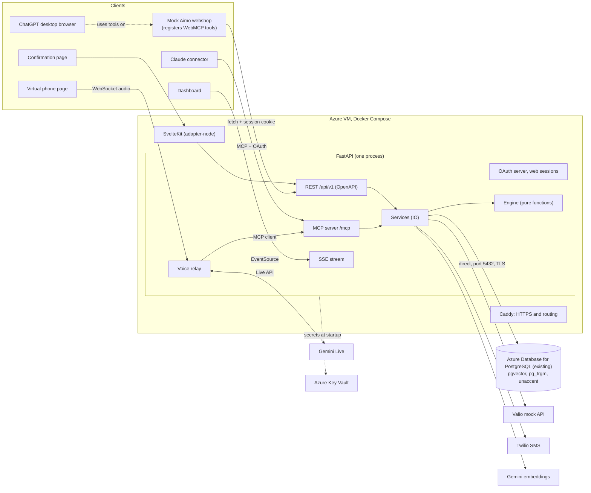
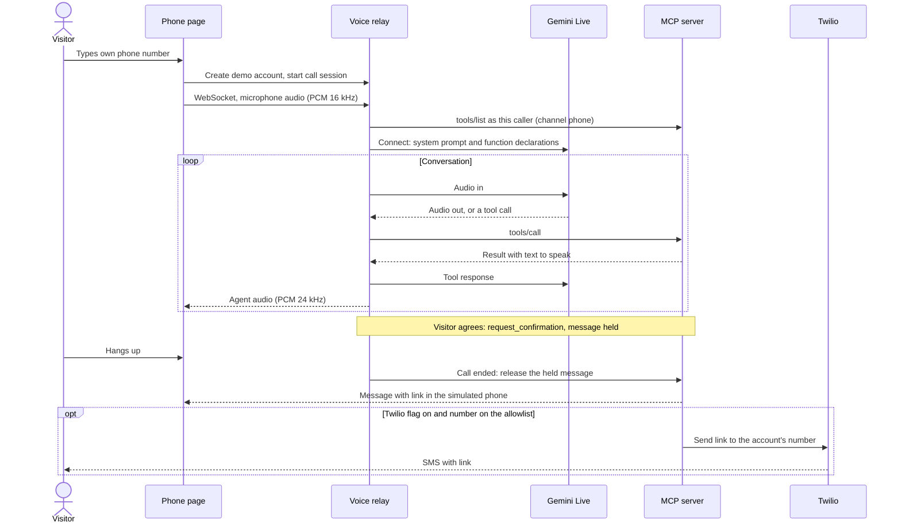

# Technical implementation plan

Status: draft v4, 2026-11-14, after two review rounds, the UI design check and a check against `docs/specs/`. Built on `vision.md` (source of truth), `valio-api-analysis.md`, the files in `data/`, the UI specs in `docs/specs/` and the team answers recorded in section 1. Section 9.8 lists where later decisions differ from `docs/specs/`. **The existing GitHub issues (#1 to #21) are not a source for this plan.** New issues will be created from this spec and should reference it. Where the plan suggests something vision.md does not settle, it is marked *proposed*. Section 14 lists what moves to follow-up issues.

## 1. Decisions this plan builds on

Taken on 2026-11-14, in addition to vision.md:

| Topic | Decision |
|---|---|
| Backend | Python, FastAPI |
| Frontend | SvelteKit |
| Cloud | Azure (we have credits). The app containers (Caddy, FastAPI, SvelteKit) run on one VM with Docker Compose. Not Container Apps or Web Apps, because their 240-second request limit may cut voice calls and the dashboard stream (section 10) |
| Database | The deployed app on the VM uses the existing Azure Database for PostgreSQL instance (`junction_demo`). `vector`, `pg_trgm` and `unaccent` are allowed on the server. Development uses Postgres with pgvector in Docker on each laptop. We revisit this once we know how many developers change database data or schema at the same time (section 10.1) |
| Voice path | Our server relays audio between the browser and Gemini Live. The server is an ordinary MCP client |
| SMS | Twilio |
| Product images | The image file's `code` is the product file's `id`. Images are hotlinked from their `img` URL |
| Connector login | Our own OAuth 2.1 authorization server, built on the MCP Python SDK's auth routes, with our own email and password page |
| Recipe embeddings | Gemini embeddings, stored in pgvector |
| Clock | A business clock frozen at Thu 2026-11-12 09:00 for cutoffs and delivery dates. The real clock for the duplicate check, audit timestamps and quote expiry when it is on |
| SMS after a call | Sent only if the visitor agreed. The agent calls `request_confirmation` once the visitor says yes during the call. The message is held and goes out when the call ends, also if the call drops. Without agreement nothing is sent (decided 2026-11-14, same as `docs/specs/call-screen.md`) |
| Secrets | Azure Key Vault in production, with no `.env` on the VM. A local `.env` only on laptops for development (section 10.2) |

Taken from the UI specs in `docs/specs/` (2026-11-14). The specs README says they win over vision.md until vision.md is updated:

| Topic | Decision |
|---|---|
| Quote expiry | Off during the event (`quote_ttl` unset), for example 30 minutes in production. After confirming, the link stays readable as a receipt until the end of the event |
| Demo companies | Each new number gets a generated company with a unique, funny-sounding Oy name. The same number gets the same company |
| Kitchen profile | The visitor chooses the exclusions on the call page. The seeded order history is decided in #61 (`docs/plans/61-order-history.md`) and built in #32 (`data/demo_histories.yaml`, section 14) |
| Conversation in the audit log | Buyer and agent turns and every tool call with its response are audit events. They are shown on the public dashboard (section 9.5) |
| Webshop | Our own static page in the Aimo webshop's style, with about 12 real products from the product file. No scrape and no Valio or Aimo logos (decided in #56). It registers the WebMCP tools (P0) and gets the S.I.MO chat panel (stretch), which runs on Gemini like the phone |
| Recipe orders | Only ingredients with a product link (`data/recipe-product-map.json`) are ordered. The rest are listed as "not ordered" (confirmed by Jesse 2026-11-14, now also in vision §7). Not built yet: #34 implements it (section 5.4) |
| Confirmation page | Follows the language of the call or chat. After an edit, only new or changed flags need a new acknowledgement |
| Call screen | Phone on speaker with live captions for both sides, not held to the ear. The agent is called S.I.MO and greets the caller by company name |
| Token after an edit | The token belongs to a confirmation that points to the current quote. Confirm must send the hash of the quote on screen |
| Substitute price limit | An automatic swap may be at most 10% more expensive. The value is configurable in `policy.yaml` |
| Rounding | Line total = quantity × gross unit price, rounded up to the next cent. Nothing is rounded before that |
| Missing price or availability | The agent explains that the price or stock could not be checked and asks whether to try again |
| Call language | The agent follows the caller's language. A setting can force Finnish or English |
| Connector accounts | Both: self sign-up, and accounts we create and hand out |
| Demo login | Typing a phone number (real or fake) on the demo page creates a demo user and logs that browser in. That browser session is the login; these users have no password |
| Dashboard access | **Decided by the team 2026-11-14**: everything on the dashboard is public, with no login: orders, steps, transcripts, tool calls and payloads. Phone numbers and emails are only ever shown masked. The confirmation token, the link and the simulated inbox stay private. No operator role or login. This replaces the earlier split (general data public, chat logs and contact details private) and is now in vision §8, §11 and §13. Production is revisited in #70 (section 9.5) |
| Confirmation messages | Every message goes to the simulated phone inbox, which is shown on the phone page only. Real SMS through Twilio sits behind a feature flag that is off by default. Even with the flag on, only phone numbers on an allowlist get a real SMS. Production would use SMS only |

Constraints from vision.md that shape the architecture:

- Deterministic engine, no LLM inside. Same input and policy version give the same decision and quote hash (§3).
- No agent tool can confirm. The only place to confirm is the page behind the SMS link (§3, §6, §8).
- One MCP server over Streamable HTTP, with the same operations documented as OpenAPI (§8).
- Product search runs locally on the product file loaded into Postgres. Price and availability are fetched only for a shortlist and cached for about five minutes. A 429 means wait 30 seconds (§10).
- Injectable clock, demo clock Thu 2026-11-12 09:00, `closingTime` enforced (§10). This overrides section 12 of `valio-api-analysis.md`.
- Live API or recorded snapshot, behind a switch (§10).
- Gross totals in integer cents, decimal arithmetic, deposits not added (§10).
- Hash-chained append-only audit, dashboard updated by push (§11).
- Quotes signed as JWS with a published key (§12).

## 2. Architecture



Three layers inside FastAPI:

1. **Interfaces**: MCP tools, REST routes, the voice relay, the Twilio webhook, OAuth and the SSE stream. They parse, authenticate and call a service. No business logic.
2. **Services**: gather the inputs (products and history from Postgres, price and availability from the Valio adapter, the kitchen profile, the clock), call the engine, store the quote, write audit and status events, send SMS.
3. **Engine**: `decide(EngineInput) -> EngineOutput`. No database, no HTTP, no clock reads, no randomness. Everything it uses is in its input.

Because the engine is pure and the full `EngineInput` is stored in the audit event, any decision can be replayed. That makes the determinism principle a test (section 11), not a promise.

REST and MCP share one set of Pydantic models and one service layer. FastAPI turns the models into the OpenAPI document. The MCP tools use the same models for their input schemas, so the two surfaces cannot drift apart.

## 3. Build or use out of the box

| Component | Use out of the box | We build | Priority (vision §13) |
|---|---|---|---|
| HTTP API and OpenAPI | FastAPI generates OpenAPI 3.1 from Pydantic v2 models. `extra="forbid"` rejects unknown fields (vision §8) | Routes under `/api/v1`, request and response models | P0 |
| MCP server | MCP Python SDK (`FastMCP`), Streamable HTTP, mounted into FastAPI at `/mcp`. MCP Inspector for manual testing | The eight tools of vision §8 (it lists `search_recipes` and `get_recipe` in one row) as thin wrappers over services. Tool descriptions written for a voice agent | P0 |
| Ordering engine | Python `decimal`, `zoneinfo` | All of it: resolve, allergen and diet filter, units, availability and dates, ranking, substitution, price, sanity checks, decision, explanation text | P0 (sanity checks, tuned ranking and exact-fit are P1) |
| Rules and texts | YAML and CSV loaders | Versioned rule files, reason-code templates in Finnish and English, a name table for unit codes (`KI`, `ST`, `PAK`, ...) | P0 |
| Product search | Postgres full-text search (`finnish` and `english` configs), `pg_trgm` for typos, `unaccent`, pgvector with Gemini embeddings for product names | Loader for the product file, search SQL, a short synonym list, name vectors, deterministic ranking | P0 |
| Recipe search | pgvector (HNSW index), Gemini embeddings, Postgres full-text search | Embedding script, hybrid query, scaling to portions | P1 |
| Valio API client | `httpx` (async) | Rate limiter, 429 back-off, 5-minute cache, snapshot record and replay, sales-unit cross-check | P0 |
| Quote hash and signature | `rfc8785` (canonical JSON), `joserfc` (JWS with EdDSA), `cryptography` | Quote model, hash, JWKS endpoint | P0 |
| Confirmation token | `secrets.token_urlsafe(32)` (256 bits), SHA-256 | Token table, single-use and expiry rules | P0 |
| SMS | Twilio Messages API, `twilio` SDK, delivery status callbacks | SMS service that delivers every message to the simulated phone inbox, and through Twilio to allowlisted numbers when the flag is on. Message text, status webhook | P0 |
| Confirmation page | SvelteKit server rendering, Svelte's default escaping | Odd things first with acknowledgements, asked-and-added lines, edit and re-quote, confirm, cancel, "order received" | P0 |
| Voice agent | Gemini Live API (`google-genai` SDK, function calling), browser `getUserMedia` and `AudioWorklet` | Audio relay, MCP-to-Gemini tool bridge, system prompt, call screen, demo account on number entry, SMS after hang-up | P0 |
| Webshop with WebMCP | The `modelContext` API in the ChatGPT desktop app's browser. The MCP-B polyfill or Chrome's testing flag for ordinary Chrome | A static webshop page of our own in the Aimo style (#56), WebMCP tool registration calling `/api/v1`, and the S.I.MO chat panel (stretch) | P0 (chat panel stretch) |
| Claude connector | Claude custom connectors (remote MCP URL plus OAuth). MCP Python SDK auth routes (metadata, client registration, authorize, token, PKCE). `argon2-cffi` for password hashes | Users table, the SDK's authorization-server provider backed by Postgres, login and sign-up pages | P1 |
| OpenAI connector | ChatGPT custom MCP connectors | Testing only | P1 |
| Live dashboard | Server-Sent Events (`sse-starlette`), Postgres `LISTEN/NOTIFY`. The listener needs a direct connection on port 5432, because PgBouncer in transaction mode drops notifications | Status events, plain-language step texts, one public view | P0 |
| Audit trail | Postgres, SHA-256 | Append-only hash-chained table, database privileges, chain checker | P0 |
| Database | Deployed: the existing Azure Database for PostgreSQL instance, with `vector`, `pg_trgm` and `unaccent` allowed in `azure.extensions` (done 2026-11-14). Development: the `pgvector/pgvector` image in Docker. SQLAlchemy 2, Alembic | Schema, migrations (the first one runs `CREATE EXTENSION`), loaders, seed data | P0 |
| Hosting | Azure VM, Docker Compose, Caddy (automatic HTTPS), Azure Key Vault with a managed identity, `azure-identity` and `azure-keyvault-secrets` | Compose file for the app containers, a development override with the database, Caddyfile, deploy script, a settings loader for `.env` or Key Vault | P0 |

In short: protocols, transport, crypto, search primitives, speech and SMS come off the shelf. The engine, the data loaders, the confirmation flow, the relay and the four web pages are ours.

## 4. Engine

### 4.1 Contracts (proposed)

Input to `build_quote`, one call with all lines (vision §8). The agent sends structured lines and the engine never sees raw speech (vision §5):

```python
class LineRequest(BaseModel, extra="forbid"):
    line_id: str
    product_id: str | None = None   # when the agent already knows the product
    usual: bool = False             # "my usual butter"
    text: str | None = None         # product words only, e.g. "maito" or "milk"
    claims: list[Claim] = []        # lactose_free, gluten_free, vegan, ...
    category: str | None = None     # category code from data/valio_category_names.csv
    quantity: Decimal
    unit: RequestedUnit             # litre, kg, piece, sales unit, or a packaging word
    needed_by: date
    recipe_ref: RecipeRef | None = None
```

`EngineInput` = the lines, the kitchen profile (allergen and diet exclusions), a history summary, the candidate product records, one offer per candidate (price and availability, with fetch time and source live or snapshot), the rule set with its version, business "now" and the quote issue time.

`EngineOutput` = a decision (`ready`, `needs_clarification` or `rejected`), priced lines (asked, chosen, quantity in sales units and in the asked unit, gross unit price as an exact decimal and line total in cents, delivery date, reason codes, trace), flags (code, whether the buyer must acknowledge it, Finnish and English text), alternatives, at most one clarification question, a next step for every rejection, text to speak in Finnish and English, and the quote when the decision is `ready`.

### 4.2 Pipeline per line

| Step | Rule | Source |
|---|---|---|
| Validate | Strict schema, limits on line count, string length and quantity | vision §8 |
| Resolve | A named product id must exist (otherwise stop). "My usual" comes from history. Otherwise run local search. Ambiguous matches go to the buyer | vision §3, §6 |
| Allergen and diet filter | A listed `CONTAINS` or `MAY_CONTAIN` for an excluded code blocks. No listing or `UNDECLARED`: orderable, flagged once per order. `X99` never blocks. Milk-free blocks `AM` and `ML` (a lactose-free claim never clears it), lactose-free on `ML` plus the `LACTOSE` claim, nut-free on `AN` plus the specific nuts, gluten-free on the `GLUTEN` claim together with `AW`. Codes come from `data/gs1_allergen_codes.csv`. The same filter runs on every substitute. A conflict is a hard stop | vision §6, §10; analysis §11, §13 |
| Availability and date | Schedule line exists, amount above 0, `salesBlock` false at both levels, `availableDate` on or before needed-by, business "now" before `closingTime`. 999999 or more: orderable, flagged as unverified. Empty schedule: not available | vision §10 |
| Units | Sales unit comes from availability, checked against `units[]` and the price ratio (unit price ÷ comparison price = litres or kilos in one sales unit, 5% tolerance). Disagreement is `UNIT_UNKNOWN`, a hard stop. Conversion uses `unitConversions`. When none reaches litres or kilos, a pack size read from the name ("1 l", "6 x 150 g") is used and flagged. An unknown conversion, or a packaging word that could mean two sizes, goes to the buyer as a question (decided in #38) | vision §6, §10 |
| Rounding | Whole sales units (`allowedLotSize` is not used). Waste first (decided in #38): candidates whose overage is at most one unit and 2% rank before all others, and only they are offered as alternatives. If none is within the limits, the least overage wins and the buyer must acknowledge the round-up. A named product beyond the limits gets a `choose` flag instead when another candidate fits within them: keep the surplus or take the exact fit (#42). One product per line; mixing pack sizes is out of scope | vision §6, §10 |
| Rank | Waste (see Rounding), price, stock certainty, history, Finnish origin first. Ties broken by product id (decided in #39) | vision §6 |
| Substitute | Only when the line cannot be filled. The quote service marks which candidates are substitutes (`EngineInput.substitutes`). Order of tries: same product in another pack (same category, same name once the pack size is removed), then a curated `substitutions[]` pair, then a similar product, then a callback request. Automatic only for the first two, flagged for acknowledgement, and only if no allergen is added and the substitute is at most 10% more expensive per kg or litre (configurable); when the prices can't be compared, there is no automatic swap. Otherwise, and for a similar product, the buyer is asked in the call, with the substitute as the option. Substitutes rank by ladder step, waste and the service's candidate order before price (decided in #39). Splitting on partial stock is the buyer's choice | vision §4, §6; review |
| Price | Gross unit price from `valueWithTax`, kept as an exact decimal. Line total = quantity × unit price, rounded up to the next cent. Order total = sum of line totals. `validTo` must cover the delivery date. If price or availability can't be fetched (`error: true`, API down, no snapshot) for the named product or the best candidate that suits the kitchen, the line isn't quoted: the agent explains and asks whether to try again (returned as `needs_clarification`). A lower candidate that fails is skipped and counted in the trace (decided in #39) | vision §10; analysis §3, §11; review |
| Sanity checks (P1) | Unusual quantity: under half the smallest or over twice the largest past quantity of the product, with at least 3 past orders, compared in sales units. Possible duplicate: the product was in an order confirmed within two hours (real clock); the quote service adds confirmed orders to the history. These flags need an acknowledgement and never block. No "never ordered before" flag (dropped in #42) | vision §6 |

Then for the whole order: one notice that lists every product without allergen information (customers with an exclusion only, analysis §13), the decision, and the quote.

### 4.3 Rules as data (`policy/`)

- `policy.yaml`: version, confirmation `always`, quote lifetime (`quote_ttl`: off for the event, for example 30 minutes in production), maximum call length (`max_call_seconds`: 600, so 10 minutes, decided 2026-11-14; the spec leaves it to the backend), cache lifetime 300 seconds, rounding limits (1 unit, 2%), duplicate window 2 hours, `enforce_closing_time: true`, demo business time, substitute price limit (10% more expensive), call language (`auto`, `fi` or `en`, default `auto`).
- `allergen_rules.yaml`: each exclusion as a set of GS1 codes, built from `data/gs1_allergen_codes.csv`. Its keys are the kitchen choices on the call page: milk-free, lactose-free, gluten-free, nut-free, egg-free, fish-free and vegan (`docs/specs/call-screen.md` §2.2). Lactose-free and vegan also need claim rules (the `LACTOSE` free-from claim, the `VEGAN` claim), not only allergen codes. Nut-free also blocks peanut (`AP`) and pine nut (`PN`), but not coconut (`SO`) (decided in #60).
- `messages.yaml`: one Finnish and one English template per reason code and flag. Uses `data/allergen_containment_levels.csv` and the partitive allergen names for Finnish sentences.
- `unit_codes.csv`: display names for unit codes in Finnish and English.

The rule-set version goes into every quote hash.

Two clocks (decided 2026-11-14). A business clock, frozen at the demo time, gives the engine its business "now" for cutoffs and delivery dates. The real clock is used for the two-hour duplicate window, audit timestamps and quote expiry when it is on. Without this split, a frozen clock would break "same order 20 minutes ago" and expiry in production.

## 5. Data and storage

### 5.1 Sources

| Source | How we get it | Loaded into |
|---|---|---|
| Product file (87 MB JSON) | `curl -L` once from `/api/products/download` (CLAUDE.md). Not committed | `products` and child tables |
| Category names | `data/valio_category_names.csv`: English and Finnish names for all 349 categories, with the Finnish name taken from the real webshop where it could be matched (`valio-api-analysis.md` §14) | `categories` |
| Allergen codes and phrases | `data/gs1_allergen_codes.csv`, `data/allergen_containment_levels.csv` | `allergen_codes`, message templates |
| Recipes | `data/valio-recipes.json` (2,091 recipes) | `recipes`, `recipe_ingredients`, `recipe_tags` |
| Recipe-to-product links | `data/recipe-product-map.json` | `recipe_product_links` |
| Product images | The image file still to come (`code`, `name`, `img`) | `product_images`, joined on `code` = product `id` |
| Carbon and reliability CSVs | API downloads | Stretch |
| Customers, kitchen profiles, phone numbers, order history | Our seed script. No real people (vision §10) | `companies`, `users`, `kitchen_profiles`, `order_history_lines` |

Every loader can be re-run: it reloads in one transaction and prints counts and anomalies (for example image codes with no matching product).

### 5.2 Tables

- **Catalogue**: `products` (id, names fi/sv/en, category, sales unit from the file, base unit, GTINs, temperature class, vendor, origin, variable unit, raw JSON), `product_units`, `product_unit_conversions`, `product_allergens` (code, containment), `product_claims`, `product_labels`, `product_substitutions`, `categories`, `product_images`, plus search columns (`tsvector` in Finnish and English, trigram index) and the name vectors (`product_embeddings`, `query_embeddings`, section 5.3).
- **Recipes**: `recipes`, `recipe_ingredients`, `recipe_tags`, `recipe_embeddings` (`vector(768)`), `recipe_product_links`.
- **Customers**: `companies`, `users` (name, phone in E.164, email, password hash, company), `kitchen_profiles`, `order_history_lines`.
- **Ordering**: `sessions` (channel, user, call id), `quotes` (hash, JWS, status, expiry, engine input and output as JSON), `quote_lines`, `confirmations` (token hash, quote, recipient, expiry, used at), `orders`, `order_lines`, `callback_requests`, `sms_messages` (Twilio id, delivery status).
- **Valio data**: `api_cache` (endpoint, product id, requested date, response, fetched at), `api_snapshots`.
- **Audit and live view**: `audit_events`, `status_events`.
- **Auth**: `oauth_clients`, `oauth_codes`, `oauth_tokens`, `web_sessions`.

### 5.3 Product search

Deterministic: the same query text on the same data always gives the same ids in the same order (`api/app/search/`, `docs/plans/30-product-search.md`):

1. Hard filters first: requested claims from `product_claims` (lactose-free is the `LACTOSE FREE_FROM` claim, never the name; analysis §11), category if given.
2. Text match on product names in Finnish and English, the category names in both languages and a short synonym list (`milk` → `maito`), using `websearch_to_tsquery` in the `finnish` and `english` configs. The Finnish Snowball stemmer handles common inflections. Trigram similarity catches typos and transcription errors.
3. Order by score, then product id. The top 20 for each line become the shortlist for price and availability (decided 2026-11-14, `SEARCH_LIMIT` in `api/app/services/quotes.py`), with at most 100 product ids per quote.

A vector index on product names is built too (#30, migration `0012`; vision §7 allows more indexes). Each product's Finnish and English name and its category are embedded once with `gemini-embedding-001` at 768 dimensions into `product_embeddings`, with an HNSW index. The 50 nearest products add candidates, and their cosine similarity adds to the score. Query vectors are cached per query text in `query_embeddings`, so the same text always gives the same vector. `SEARCH_VECTORS` picks `live` (embed a query that isn't cached yet, and search by text only if that fails), `cache` (never calls the API, for the stage) or `off` (text only). Vectors only add candidates and score, so the engine's choice stays deterministic.

### 5.4 Recipes (P1, Jesse owns the recipe issues #34 and #80, vision §7)

Today `search_recipes` and `get_recipe` run on two fixture recipes (`api/app/services/fixtures/recipes.json`) with a match on the name. The loader, the embeddings and the hybrid search below are #34.

- Embed each recipe once (name, description, ingredient names, tags) with the Gemini embedding model at `output_dimensionality` 768. pgvector's HNSW index takes at most 2,000 dimensions for the `vector` type. The script saves the vectors to a file, so `junction_demo` and every laptop database load them without calling the API again (*proposed*).
- Search: embed the query at request time, rank by vector and by full-text search, merge with reciprocal rank fusion, filter by taxonomy. Diet tags are only a search hint (vision §7).
- `get_recipe` scales `singlePortionAmounts` to the portion count, and gives an ingredient a `product_id` only when `recipe-product-map.json` links it. In `build_quote`, only ingredients with a product link are ordered. The rest go to `not_ordered[]`, so the buyer knows to get them elsewhere. Decided in `docs/specs/webshop-chat.md` §4.3 and confirmed by Jesse on 2026-11-14; vision §7 now says the same.
- Not built yet (#34 implements it): today the engine doesn't use `recipe_ref` and always returns an empty `not_ordered[]`. The agent sends each ingredient as a line with `group` set to the recipe name, so an unlinked ingredient goes in by its name and through normal product search (section 5.3), and one with no match comes back as a clarification (`NO_MATCH`).

### 5.5 Images and category names

- `` with a placeholder when the image is missing or fails to load. Only pages that are actually rendered fetch from Valio's media server. We never prefetch the catalogue's images.
- `name_fi` and `name_en` are used for voice and display. `mandate_group` is a coarse grouping for search filters and the dashboard. It is never used for allergens and never as "chilled" or "fresh" (category brief).

## 6. Valio API adapter

- `httpx.AsyncClient` with `X-API-Key` from `VALIO_API_KEY` and `User-Agent: curl/8.4.0` (Cloudflare blocks Python's default).
- One batched call per endpoint per shortlist. Price and availability run in parallel.
- A token bucket at 5 requests per second (decided 2026-11-14, `TokenBucket` in `api/app/adapters/valio.py`), below our reading of a roughly 10 per second burst limit. On 429: wait 30 seconds, retry once.
- Cache in Postgres for 300 seconds, keyed by endpoint, product id and requested date.
- `VALIO_SOURCE=live | record | snapshot`. `record` calls live and stores every response. `snapshot` reads only stored responses, and a missing one is logged loudly. Snapshots live in `data/snapshots/` (no key inside, safe to commit).
- Normalisation at the edge: prices as exact decimals (totals become cents in the engine), sentinels to "unverified", empty schedule to "not available", the sales-unit cross-check from section 4.2.
- Availability is called again at confirmation, for the quote's products only (vision §10).

## 7. Channels

### 7.1 Phone (P0, main stage demo)



- **Browser**: `getUserMedia`, an `AudioWorklet` that downsamples to 16 kHz 16-bit mono, binary WebSocket frames. Playback through a second worklet. When Gemini reports an interruption, the playback buffer is flushed so the caller can talk over the agent.
- **Relay**: `google-genai` `client.aio.live.connect`, one asyncio task per direction. Sessions are held in memory, which is why the API runs as one process (section 10).
- **Only after a yes** (decided 2026-11-14): the agent asks whether to send the confirmation link and calls `request_confirmation` only after the visitor clearly agrees. On the phone channel the service holds the message until the call ends. The relay's hang-up handler then releases it (an internal call, not an MCP tool), also when the call drops. If the visitor never agreed, nothing is sent, and the dashboard shows that the call ended without a confirmation request.
- **Tool bridge**: at call start the relay lists the MCP tools and turns their JSON Schemas into Gemini function declarations. It authenticates to MCP as the identified caller with a short-lived token from our own auth server, so MCP treats the phone like any other client (vision §2: no client is special).
- **Model and platform**: a 3.x Live model through the Gemini API (AI Studio key, API version `v1beta`), not Vertex AI. Finnish is listed only for the 3.x audio models, and the Vertex "Configure language and voice" page does not list it. Decided 2026-11-14 after the spike (#51): `gemini-3.8-live`, with the voice **Achird**, chosen by listening in #67 (`voice_model` and `voice_name` in `api/app/settings.py`). Google's docs list synchronous and asynchronous function calling for it, but in the spike asynchronous calls did not make the agent keep talking while `build_quote` ran. The relay plays a short spoken filler line instead when a tool call takes longer than about 1 second (`spikes/gemini-live/README.md`).
- **Finnish** (researched 2026-11-14): Finnish (`fi`) is in Google's table of additional languages for 3.x audio models, not in the base 24 that every audio model supports. The native audio models detect the language themselves and take no `language_code`. By default the agent follows the caller. The `call_language` setting can force Finnish or English, which becomes one line in the system prompt ("Always respond in Finnish"). Quality was measured in #51 (TTS audio) and #67 (a real voice): without a `custom_vocabulary`, real speech breaks product names, and with one, 63 of 66 key terms came through. So the relay always passes about 100 terms from the catalogue (brands and long compound words, `voice_calls.custom_vocabulary`). Recognition can still be weaker than for the major languages, and background noise makes it worse. Two existing parts of the design soften this: search tolerates typos (trigram), and the confirmation page shows what we understood next to what we added, so a misheard word is easy to spot (vision §6).
- **System prompt** (ours, shared with the webshop chat): the agent is S.I.MO, greets the caller by company name and says it is an AI helper. Collect all lines, then one `build_quote`. One clarification per turn. Speak the top pick and at most one alternative (vision §5). Give the no-allergen-listing notice once, at the end. Never say the order is placed. Ask whether to send the confirmation link, call `request_confirmation` only after a clear yes, and say the link comes to the phone after hanging up. When a decision cannot be overridden, say so and move on.
- **Ending the call**: the visitor hangs up, or the agent ends the call once the order is ready (`docs/specs/call-screen.md` §2.3). For that, the relay gives Gemini one local function, `end_call`, next to the MCP tools. It is not an MCP tool. Decided 2026-11-14: a call lasts at most 10 minutes (`max_call_seconds` 600 in `policy.yaml`). At 9:00 the relay tells S.I.MO that one minute is left, and at 10:00 it ends the call (`ended_by` time limit).
- **Call screen** (`docs/specs/call-screen.md`, `docs/design` screens 10 to 14): phone-app flow (set up, Contacts, call, ended), phone on speaker with live captions for both sides, timer, mute, speaker, hang-up. Screen Wake Lock keeps the call alive. No proximity sensor (vision §9).

### 7.2 Webshop: WebMCP (P0) and chat panel (stretch)

- The page is our own static markup in the Aimo webshop's style (decided in #56, `web/src/routes/shop`): no scrape, invented copy, and no Valio or Aimo logos or wordmarks. It shows category tiles and twelve real products from the product file (name, pack size, category, image when we have one), picked by `scripts/select_shop_products.py` into `web/src/lib/shop/products.json`. No prices or stock on the page: those come only through the tools. It has no cart, search or login of its own. Its language follows the browser (`Accept-Language`), with an EN/FI toggle.
- Visitors identify with the same phone-number entry as the call (section 9.2), so they get the same demo company and kitchen profile.
- **WebMCP (P0)**: the page registers the same operations as the MCP tools through `document.modelContext`, falling back to `navigator.modelContext` (the API moved between the two in 2026). Each tool calls `/api/v1` with the session cookie.
- **S.I.MO chat panel (stretch)**: it runs on Gemini on our server, with the same agent prompt as the phone, as an MCP client like the voice relay (`POST /api/v1/chat`, section 9.6). Cards are rendered from tool results, never from model text.
- OpenAI side: OpenAI announced WebMCP support in the ChatGPT desktop app's built-in browser in August 2026. Check this on day one with our own page. For ordinary Chrome, use the MCP-B polyfill or Chrome's testing flag.
- TypeScript types are generated from the OpenAPI document (`openapi-typescript`), so the web tools follow the backend schemas.

### 7.3 Claude connector (P1)

- The connector URL is `https://<host>/mcp`. FastAPI serves the OAuth protected-resource metadata (RFC 9728) and authorization-server metadata. The MCP SDK's auth routes handle client registration, authorize with PKCE and token. Our provider stores clients, codes and tokens in Postgres. Authorize redirects to the SvelteKit `/login` page (email and password) and back.
- Claude lets you add a custom connector with auth turned off, so the tools can be tested before login works.
- Accounts (decided): both self sign-up (email, password and phone number) and accounts we create and hand out to judges and peers. A handed-out account gets the recipient's own phone number, because the confirmation SMS goes there.
- Tool results carry structured fields and product names only. Marketing text is never sent to an agent (*proposed*; vision §8 treats all product free text as data).

### 7.4 OpenAI connector (P1)

The same MCP URL as a custom connector in ChatGPT. Check its auth requirements when we get there.

## 8. Quote, confirmation, order, audit and dashboard

### 8.1 Quote

- Hash: SHA-256 over RFC 8785 canonical JSON of customer, lines, totals, delivery dates, issue time, expiry and rule-set version.
- Signature: compact JWS with Ed25519 (EdDSA) and a `kid`. The public key is published at `/.well-known/jwks.json` (vision §12).
- Each line carries labelled claims: stock verified or unverified, price from the API, origin from product data (vision §12).
- Status: `ready` → `pending_confirmation` → `confirmed`, `cancelled`, `expired` or `void` (replaced by an edit or by worse availability).

### 8.2 SMS link

- `request_confirmation(quote_id)` has no recipient argument. The recipient is the identified user's registered number (vision §6).
- Delivery (decided 2026-11-14):
  - **Simulated phone inbox**: every message lands in the inbox of the account that made the order. It is shown on the phone page only. This is our own path, so the demo never depends on an SMS provider.
  - **Real SMS**: Twilio sends only when the feature flag `SMS_TWILIO_ENABLED` is on (default off) and the number is on the allowlist `SMS_ALLOWLIST`. Every other number gets the inbox message only, so a made-up number that belongs to a stranger never gets our SMS.
  - **Allowlist**: holds real phone numbers, so it lives in Azure Key Vault (comma-separated E.164 numbers), never in the repo (section 10.2).
  - **Vision**: this deviates from vision §6, where the SMS is the only path. The inbox is a demo setting (`demo_inbox`, on for the event). Production would use SMS only.
  - **Webshop visitors**: the inbox isn't shown in the shop. A webshop visitor reads the message in the simulated phone on the phone page, in the same browser.
- The token is 256 random bits, stored as SHA-256. It belongs to a confirmation that holds the recipient and points to the current quote (decided). It expires with the current quote, which doesn't happen during the event.
- Link `https://<host>/c/<token>`. *Proposed*: opening the link never uses it up, so SMS link previews and repeated opens do no harm. Confirm or Cancel uses it up for actions. After that the link stays readable as a receipt until the end of the event (`docs/specs/confirmation-page.md` §7).
- Twilio sends with a status callback to `/api/v1/twilio/status` (Twilio signature checked). A failed delivery appears on the dashboard. The simulated inbox still has the message, so the buyer can confirm from there. With the inbox off, nothing is ordered and a resend can be offered (vision §6).
- Twilio setup: a trial account only sends to verified numbers. With the allowlist that may be enough: verify each allowlisted number in Twilio, and upgrade only if the trial's limits get in the way. Check the sender-id rules for Finland at the same time.

### 8.3 Confirmation page (`/c/[token]`)

- Rendered on the server by SvelteKit from FastAPI data only (vision §6).
- Odd things first, each with an acknowledge box. Confirm stays disabled until every box is ticked.
- Asked and added side by side, grouped by request. Quantities in sales units and in the asked unit, delivery date, gross total, and a readable trace.
- Edits (quantity, remove a line, pick an alternative) run the engine again and produce a new quote on the same page. The old quote becomes void and the confirmation points to the new one. Confirm must send the hash of the quote on screen, so a stale tab cannot confirm an old version. Acknowledgements carry over to the new quote by `flag_key`. Only new flags, or flags whose text changed, need a new acknowledgement.
- The page uses the language of the call or chat, with a toggle. The page states are listed in `docs/specs/confirmation-page.md` §3.
- Confirm re-checks availability. If it got worse, the quote is void and a new one is shown. Otherwise the order is created and the page shows "order received".
- Product text is escaped (Svelte's default, never `{@html}`).
- `/c/*` responses carry `Referrer-Policy: same-origin`, `Cache-Control: no-store` and `X-Robots-Tag: noindex` (`web/src/hooks.server.ts`). `same-origin` keeps the token out of Referer headers towards every other site, including the hotlinked image host. Not `no-referrer`: with it, browsers send `Origin: null` on a plain form post, and SvelteKit's CSRF check then refuses every action when JavaScript is off.

### 8.4 Order record

`orders` and `order_lines` in our database (vision §10). `get_order_status` returns pending confirmation, confirmed, cancelled or expired. Peppol export is a stretch goal.

### 8.5 Audit

- `audit_events(seq, at, type, actor, session_id, quote_id, payload, text_fi, text_en, payload_hash, prev_hash, session_prev_hash, hash)` (decided in #41). `payload_hash` is SHA-256 over the RFC 8785 JSON of the payload and both sentences. `hash` is SHA-256 over `prev_hash`, `session_prev_hash`, `seq`, `at`, `type`, `actor`, `session_id`, `quote_id` and `payload_hash`, joined with newlines, with `at` in UTC to the microsecond. The exact bytes and shared test vectors are in `docs/audit-chain.md`. Chaining over `payload_hash` lets the dashboard verify the chain without the payloads, so personal data in a payload can be hidden or redacted without breaking it.
- Each event also carries `session_prev_hash`, the hash of the previous event in the same session. This lets one order's chain be verified on its own, which `docs/specs/dashboard.md` §3.4 needs, while the global chain still covers everything.
- The writer (`app/services/audit`) takes a transaction-level advisory lock (`pg_advisory_xact_lock`) so the chain stays linear. It is released at commit, so it would also work through transaction pooling, but the app connects directly anyway (section 10.1). The application's database role has only `INSERT` and `SELECT` on the table, and a trigger refuses `UPDATE`, `DELETE` and `TRUNCATE` for every role, the owner included.
- Events: request, candidates considered, filters applied, choice and reason codes, quote, SMS sent or failed, confirmation (vision §11). The full engine input is stored so any decision can be replayed.
- Conversation turns (`buyer_said`, `agent_said`) and tool calls with their full responses (`tool_called`, `tool_returned`) are audit events too (`docs/specs/README.md`). They are public on the dashboard (section 9.5). `docs/specs/dashboard.md` §5 lists the event types the dashboard needs.
- Events store only masked phone numbers. The full number stays in `users` and is deleted after the event (`docs/specs/call-screen.md` §6). The writer refuses an event with a full phone number, an email, a confirmation link or a token.
- Each distinct rule set is stored once in `rule_sets` (append-only, like the log) the first time a quote uses it, with a `rule_set_loaded` event that carries its hash. Engine inputs in audit payloads carry `rules_ref` in place of the full rules, and replay loads the rules by that reference.
- `scripts/verify_audit_chain.py` checks the chain (all of it, one session, or a downloaded file), for the pitch.

### 8.6 Dashboard

- A `status_events` row (a pointer: id, audit `seq`, session, type, time) is written in the same transaction as each audit event. A trigger calls `pg_notify('status_events', id)`. A FastAPI listener on its own direct connection (port 5432, not PgBouncer) pushes the events, redacted (section 9.5), over one public SSE stream. The simulated inbox has its own per-user stream (section 9.2).
- `/dashboard`: orders grouped by company. Open one to see the steps in plain words, rejected candidates, flags and confirmation state. Failures too: rejected, link expired, SMS failed, callback requested. Large type, readable from a distance.
- The relay emits call events (started, tool called, ended), so a call shows up while it is still going on.
- A periodic job marks expired quotes and emits the event, because expiry does not happen on its own. It only runs when expiry is on, which it isn't during the event.
- On connect, a stream sends a snapshot of the current sessions, then live events. Session states follow `docs/specs/dashboard.md` §4.
- Fully public (changed 2026-11-14, section 9.5): anyone can see everything without logging in, including transcripts and tool calls. Phone numbers and emails only ever appear masked, and the confirmation token and link never appear.
- There is no operator login (#62 closed as not needed).

## 9. Endpoints and messages

Checked on 2026-11-14 against the UI design in `docs/design/` (18 screens: start, call, confirmation, dashboard, webshop) and the specs in `docs/specs/`. Screen names below are the exported ones in `docs/design/screens/`. Everything under `/api/v1` is in the OpenAPI document. Paths and fields are *proposed* until the first implementation, but every screen in the design maps to a row here.

Two rules, from vision §6 and §8:

- **The confirmation link goes only to the account that made the order**: to that account's simulated phone inbox, and by Twilio SMS to allowlisted numbers when the flag is on (section 8.2). No agent tool, voice message or public endpoint returns the token or the link. The notification "Tap to check it" on `13-call-ended` fits if it opens the message in the simulated phone. The webshop's "Open confirmation page" (`42-webshop-quote`) doesn't: a browser agent works inside that page and could follow the link (vision §8). So the simulated inbox is shown on the phone page only, never in the shop (decided).
- **Agents get the eight tools and nothing else.** Confirm, cancel, acknowledgements, edits on the page and the inbox are web-session endpoints. They never accept MCP tokens and are never registered as WebMCP tools. The dashboard is public and read-only, but it is not a tool either.

### 9.1 Agent tools and their REST twins

The eight tools of vision §8 (it counts `search_recipes` and `get_recipe` as one row), unchanged. Each has a REST twin with the same Pydantic models, which the WebMCP tools in the shop call with the session cookie.

| MCP tool | REST twin |
|---|---|
| `search_products` | `GET /api/v1/products?q=&claims=&category=&needed_by=` |
| `get_customer_context` | `GET /api/v1/customer-context` |
| `search_recipes` | `GET /api/v1/recipes?q=&diet=&occasion=` |
| `get_recipe` | `GET /api/v1/recipes/{id}?portions=` |
| `build_quote` | `POST /api/v1/quotes` |
| `update_quote` | `POST /api/v1/quotes/{id}/update` (returns a new quote) |
| `request_confirmation` | `POST /api/v1/quotes/{id}/confirmation-request`, returns `{sent_to_masked, delivery_status}` |
| `get_order_status` | `GET /api/v1/quotes/{id}/status` |

Fields the screens need that section 4.1 doesn't list yet:

- **Customer context**: `company_name`, exclusions with Finnish and English labels, `phone_masked`, usual items with product id, quantity and unit ("my usual order" asks for all of them at once).
- **Line**: name in Finnish and English, `image_url` (section 5.5), `reason_text` in Finnish and English, price per kg or litre, stock status (verified or unverified), origin, `alternatives[]` (id, label, quantity, line total).
- **Request group**: `LineRequest` gets an optional `group` label that is echoed back, and the quote gives a subtotal per group (`42-webshop-quote`: "Mon, chicken curry, 3 lines, 118,40 €").
- **Trace**: candidates found, removed per reason, left, and the ranking rule ("14 found, −4 arrive after Monday, −3 out of stock, −2 contain milk, 5 safe"). Each candidate is counted once, at the first step it fails, in the order of section 4.2.
- **Flag**: stable `flag_key`, `line_ids`, `kind` (`acknowledge` or `choose`), `options[]` with line totals for `choose` (`20-confirm-check`: "Keep 24 l / Exactly 20 l"), `acknowledged_at`.
- **Quote**: `version`, `parent_quote_id`, `expires_at`, a delivery summary for the whole order, and `not_ordered[]` for recipe ingredients without a product link, which are not ordered. The engine leaves it empty until #34 (section 5.4).
- **Recipe**: `image_url` (in the data). The data has no English names, no English diet labels and no cooking time, so the design's "45 min" has no source.

### 9.2 Accounts and web sessions

| Method and path | Request → response | Screens |
|---|---|---|
| `POST /api/v1/demo/accounts` | `{phone_e164, exclusions[], lang}` → creates a demo user for this browser and sets the session cookie (this is the login). Returns `{user_id, company_id, company_name, phone_masked, exclusions, usual_items, new_company, new_user}` (`DemoAccount` in `api/app/services/accounts.py`, without the session token). Exclusions must be keys of `allergen_rules.yaml` | `10-call-setup`, `11-call-contact`, webshop |
| `GET /api/v1/private/inbox` | → `[{id, at, text, link}]` for the logged-in user. New messages also arrive on the inbox stream (SSE `GET /api/v1/private/inbox/stream`) as `inbox_message`. The inbox is the only private, per-user data left, because its link is the authorisation | Simulated phone (`13-call-ended`) |
| `POST /api/v1/signup` | `{email, password, phone_e164}` → session cookie | Connector accounts |
| `POST /api/v1/session`, `DELETE /api/v1/session` | `{email, password}` → session cookie; log out | Connector login (#48) |
| `GET /api/v1/me` | → `{user_id, company_id, company_name, phone_masked, exclusions, lang}` (`Account` in `api/app/services/accounts.py`) | Call screen, webshop chat header |

- **Company per number, inbox per user**: the same number gets the same generated company and kitchen profile (`docs/specs/call-screen.md` §2.2), so cards group by company on the dashboard. Each browser that types the number is its own user, and the simulated inbox belongs to the user who made the session. Typing someone else's number therefore never shows their confirmation links (decided, `docs/specs/call-screen.md` §6).
- **Generated company names**: unique, funny-sounding Oy names, generated by us and never typed by the visitor, so they are safe to show publicly. A change to the kitchen profile applies from the next call.

The connector's OAuth routes come from the MCP SDK (section 7.3). Every path into a call goes through the number entry, because that number is the SMS recipient and the session is the login. On a computer the same phone flow runs inside a frame (`14-call-on-computer`), number entry included.

### 9.3 Voice WebSocket (`/voice/ws`)

Binary frames carry PCM audio (16 kHz up, 24 kHz down). Text frames carry JSON:

| Direction | Message | Fields |
|---|---|---|
| Browser → server | `hangup` | none |
| Server → browser | `ready` | none (Gemini session open) |
| Server → browser | `interrupted` | none (flush playback, section 7.1) |
| Server → browser | `agent_state` | `state` (`listening`, `thinking`, `working` or `speaking`), `tool` (the tool name while `working`, otherwise null). See below |
| Server → browser | `transcript` | `who` (buyer or agent), `text`, `final` |
| Server → browser | `ended` | `duration_s`, `ended_by` (visitor, agent, time limit or dropped), `quote_id` or null, `total_cents`, `delivery_status` (`sent`, `failed`, `off` when the flag is off or the number isn't allowlisted, or `none` when the visitor didn't agree to a quote), `inbox` (true when the message is in the simulated phone) |

`agent_state` (decided 2026-11-14 in #54, sent by the relay in `api/app/interfaces/voice/relay.py`) drives the call screen's activity indicator (`docs/specs/call-screen.md` §2.3). The relay sends it only when the state changes:

- `listening`: S.I.MO waits for the caller. Sent at call start after `ready`, after each agent turn (Gemini `generation_complete`), and after `interrupted`.
- `thinking`: the caller's utterance has ended (the final input transcript, or the end of the user's turn) and S.I.MO hasn't spoken or called a tool yet; about 1 s in the spike (#51). Sent again after a tool result goes back to Gemini, until audio starts.
- `working`: Gemini called a tool, named in `tool`, until the relay sends the result back.
- `speaking`: the first output audio chunk of the turn arrived.

The browser works without it: with a relay that never sends `agent_state`, it infers speaking while agent audio is queued for playback and listening otherwise. Because `listening` follows generation, not playback, the browser keeps showing speaking while queued audio still plays.

`ended` arrives before the socket closes and covers the no-quote and SMS-failed cases. The link itself never travels on this socket: the simulated phone reads it from the inbox endpoint (section 9.2). Live captions need Gemini Live's input and output transcription turned on. Transcripts become `buyer_said` and `agent_said` audit events (`docs/specs/README.md`), shown on the public dashboard (section 9.5). They never enter the engine input (vision §5). Because the chain hashes over `payload_hash` (section 8.5), the text can be deleted after the event without breaking the chain.

### 9.4 Confirmation page (web only)

The token is in the path. `GET` never uses it up. #47 built these endpoints (`api/app/interfaces/rest/confirmations.py`) with the shapes below, which are decided as of 2026-11-14 (`api/app/schemas/confirmation.py`). The confirmation page (#55) mirrors them in `web/src/lib/confirmation/types.ts`, with its client in `web/src/lib/server/confirmation/api.ts`; keep the three in step. `CONFIRMATION_SOURCE=fixture` still runs the page against an in-memory fixture.

| Method and path | Request → response | Screens |
|---|---|---|
| `GET /api/v1/confirmations/{token}` | → the confirmation view below; 404 for an unknown token | `20-confirm-check` to `22-confirm-received` |
| `POST …/{token}/acknowledgements` | `{quote_hash, flag_key, option_id?}` → 204. `option_id` is the buyer's pick for a `choose` flag. An option that changes the order makes a new quote, with the flag acknowledged on it | "Got it", "Keep 24 l / Exactly 20 l" |
| `POST …/{token}/edits` | `{quote_hash, op: set_quantity \| remove \| choose_alternative, line_id, quantity?, alternative_id?}` → 204, and the confirmation points to a new quote; 409 if the hash is stale; 422 if the edit is not possible | Stepper, remove, alternatives |
| `POST …/{token}/confirm` | `{quote_hash}` → `{order_number, confirmed_at}`; 409 if availability got worse (the quote is replaced and the view shows the new one); 422 if a flag isn't acknowledged; 410 if expired (production only) | Confirm |
| `POST …/{token}/cancel` | `{quote_hash}` → 204 | Cancel |

The confirmation view (`ConfirmationView`) wraps the contract models in `api/app/schemas/` (`QuoteLine`, `Flag`, `NotOrdered`, `GroupSubtotal`, `DeliverySummary`) with the page state and the buyer's acknowledgements:

- `state`: `ready`, `requote_needed`, `confirmed`, `cancelled`, `expired` or `invalid`, the page states in `docs/specs/confirmation-page.md` §3.
- `lang`, `expires_at` (null while expiry is off), `company{name}`, `session{channel, started_at}`, `exclusions[{key, label}]`.
- `quote{quote_id, version, quote_hash, total_cents, delivery}`, with `delivery` a `DeliverySummary`.
- `lines[]` (`QuoteLine`, each with its `group` and `asked`), `groups[]` (`GroupSubtotal`) and `not_ordered[]` (`NotOrdered`).
- `flags[]`: each contract `Flag` plus `requires_ack` (the code's `ack` setting in `policy/messages.yaml`; `choose` flags always need one), `acknowledged_at`, `current_option_id` (for `choose`: the option the current quote already reflects) and `is_new` (new, or its text changed, since the buyer first saw the order, and not yet acknowledged).
- `change`: what changed compared with the previous quote after an edit or a requote (`reason`, `previous_total_cents`, `line_ids`, `text`), or null.
- `order`: once confirmed, `{order_number, confirmed_at, acknowledged[{flag_key, code, at}]}`, or null.

The page uses post, redirect, get: after every successful `POST` it loads the view again with `GET`, so it doesn't need the `POST` response bodies. A refused action returns its status with `{detail: {text, line_id?}}`, where `text` is in Finnish and English (`ConfirmationErrorDetail`), and the page shows that text.

Edits use the same service as `update_quote`, and acknowledgements carry over by `flag_key` (section 8.3). After confirming, the `GET` keeps working read-only as the receipt until the end of the event (§7 of that spec).

### 9.5 Dashboard: public, no login

**Decided by the team 2026-11-14**: everything on the dashboard is public, with no login. This replaces the earlier split, where transcripts, tool calls, payloads and contact details were private to the user who made the order, and closes the operator-login question (#62). It goes back to the original `docs/specs/dashboard.md` §2, and vision §8, §11 and §13 record it. Tracked in #49 and #50. What the dashboard shows in production is revisited in #70 (stretch).

| Method and path | Response | Screens |
|---|---|---|
| `GET /api/v1/public/orders?state=&channel=&since=` | `business_now`, `totals{active, waiting, confirmed, attention, confirmed_cents, by_channel}`, `companies[{name, exclusions, orders[{session_id, order_number, channel, client, identity_masked, state, state_since, title, step_text, line_count, total_cents, flags, next_step}]}]` | Overview |
| `GET /api/v1/public/orders/{session_id}` | Header, lines with trace and ranked candidates, flags (text, acknowledged or not), `quote{id, version, hash}`, signature valid | Summary |
| `GET /api/v1/public/orders/{session_id}/steps` | `[{seq, order_index, at, actor, type, text{fi, en}, payload_hash, prev_hash, session_prev_hash, hash}]` | Full flow (engine steps), Audit log |
| `GET /api/v1/public/orders/{session_id}/transcript` | The call or chat transcript | Full flow: "Buyer (transcript)", "Agent (transcript)" |
| `GET /api/v1/public/orders/{session_id}/events` | Full events: tool arguments and results, payloads, Identity row (masked); `?download=1` returns the JSON file | Full flow, Audit log JSON, "Download JSON" |
| `GET /api/v1/public/audit/verify?session_id=` | `{ok, checked, first_bad_seq, signature_valid}` | "Audit chain intact", "Verify again" |
| SSE `/api/v1/public/stream` | Snapshot, then `order_updated` (card), `step` and `transcript` events | Live updates |

- **Never shown**, even though everything else is public: the confirmation token and link, full phone numbers, full emails, session cookies and caller tokens. Events are written with masked numbers (section 8.5), and every response and stream event also goes through one redaction function.
- **Still private**: only the simulated inbox (section 9.2), because the link in it is the authorisation.
- **What it costs**: visitors' transcripts are visible to anyone with the URL, including on the big screen, so the call screen and the webshop chat notices must say so (`docs/specs/call-screen.md` §2.1, `docs/specs/webshop-chat.md` §2). Any agent that fetches the dashboard URL can read the redacted log, as vision §8 now says. The dashboard is still not a tool, no tool reads the audit log, and nothing on it can act on an order.
- "Verify again" works without login because the chain hashes over `payload_hash` (section 8.5).
- Each event has a link within its session as well as its place in the global chain (section 8.5), so one order's chain can be verified on its own. `order_index` is the event's number within the order ("#1 to #31" in the design), shown next to the global `seq`.
- Session states and event types follow `docs/specs/dashboard.md` §4 and §5.
- The client name ("Claude", "ChatGPT") comes from the OAuth client registration. A WebMCP call can't tell which agent is calling, so it shows as "browser agent".
- An MCP or WebMCP session counts as active for 10 minutes after its last tool call, since it has no hang-up. After that the dashboard shows it as abandoned, and the next tool call starts a new session (decided 2026-11-14, `IDLE_TIMEOUT` in `api/app/services/sessions.py`).

### 9.6 Webshop chat (stretch)

| Method and path | Purpose |
|---|---|
| `GET /api/v1/quotes/current` | The session's latest quote ("Current order" in the chat panel) |
| `GET /api/v1/quotes/{id}` | One quote |
| `POST /api/v1/chat` | `{conversation_id, message}` → streamed text and cards (menu, recipe, quote). Runs Gemini on our server with the shared agent prompt, as an MCP client like the voice relay, with channel `web_chat` (`docs/specs/webshop-chat.md`) |

The webshop is a static page (section 7.2), so there are no cart, product or search endpoints for it. The WebMCP tools use the REST twins in section 9.1. The confirmation page chat (stretch on top of stretch) reuses `POST /api/v1/chat` with the confirmation's quote, and it can only call `update_quote`.

### 9.7 Other

- `POST /api/v1/twilio/status`: Twilio delivery callback (signature checked). Emits `sms_delivered` or `sms_failed`.
- `GET /.well-known/jwks.json` (section 8.1), the OAuth metadata and routes (section 7.3), `/mcp`.
- FastAPI docs at `/api/v1/docs` and `/api/v1/openapi.json`, so Caddy routes them to FastAPI. The landing page links to them ("Tool list and OpenAPI docs").

New columns and event types these endpoints need:

- `sessions`: `state`, `state_since`, `ended_at`, `ended_by`, `client_name`, `prompt_version`.
- `orders`: a readable `order_number` (for example D-1042).
- `confirmations`: `opened_at`, and one acknowledgement row per flag (`flag_key`, `at`).
- `companies`: generated name. (No `users.role`: there are no operators, section 9.5.)
- `sms_messages`: one row per message and delivery path (`twilio` or `inbox`), each with its own status.
- `quotes`: `version`, `parent_quote_id`.
- `audit_events`: `actor`, `text_fi`, `text_en`, `payload_hash`, `session_prev_hash` (section 8.5).
- Event types: the list in `docs/specs/dashboard.md` §5, plus `tool_returned` (with the response sent to the agent), `stock_rechecked`, `sms_delivered` and `inbox_delivered`.

### 9.8 Where later decisions differ from `docs/specs/`

These decisions were made after the specs were written, so the specs need an update. The plan follows the later decision.

| Topic | `docs/specs/` says | Decided later (2026-11-14) |
|---|---|---|
| SMS | Twilio always sends (`call-screen.md` §2.4, §3; `confirmation-page.md` §2) | Every message goes to the simulated phone inbox. Twilio sits behind a flag that is off by default, for allowlisted numbers only (section 8.2). The per-number SMS limit in `call-screen.md` §6 then only matters for allowlisted numbers |
| Link in the webshop chat | "Open confirmation page" card in the chat (`webshop-chat.md` §2, §4.4) | The inbox shows on the phone page only, because a browser agent works inside the shop page (vision §8). Webshop visitors read the link on the phone page in the same browser |


## 10. Hosting on Azure

The database is the existing Azure Database for PostgreSQL instance. The app runs on **one Linux VM with Docker Compose** (`caddy`, `api`, `web`).

Why a VM and not Container Apps or Web Apps (asked in review, decided 2026-11-14): with the database managed, setup takes about as long either way. The difference is how long a connection may stay open. Container Apps documents a 240-second request timeout, and App Service has a similar load-balancer limit. Microsoft's docs don't say whether these also cut an open WebSocket or SSE stream, and both carry the core demo: every voice call is one WebSocket, and the dashboard is one SSE stream. On the VM:

- WebSockets and SSE have no time limit;
- Caddy serves the web app and the API on one domain, which keeps cookies and the OAuth metadata simple, and it gets HTTPS certificates by itself;
- one FastAPI process holds the voice sessions in memory, so there is nothing sticky to configure.

### 10.1 Database

- **Extensions**: `vector`, `pg_trgm` and `unaccent` are allowed in the `azure.extensions` server parameter (done 2026-11-14). Each database still needs `CREATE EXTENSION`, which the first migration runs.
- **Connections**: all app connections go straight to port 5432, not through PgBouncer. PgBouncer in transaction mode drops `LISTEN/NOTIFY` notifications (the dashboard) and keeps no session-level state. One API process needs only a few connections.
- **`DATABASE_URL`** includes `sslmode=require`, which Azure requires.
- **Databases**: the VM uses `junction_demo` on the Azure server (stage demo, judges and peers). Each laptop runs its own Postgres in Docker for development (decided in review). We revisit this once we know how many developers change database data or schema at the same time.
- **Laptop database**: the `pgvector/pgvector` image at the same major Postgres version as the Azure server. `pg_trgm` and `unaccent` ship with it. `DATABASE_URL` points at the container without TLS.
- **Firewall**: one rule for the VM's IP (or its VNet). Laptops don't connect to the server, so they need no rules.
- **Backup before the pitch**: a `pg_dump` of `junction_demo`, or the server's point-in-time restore. A VM disk snapshot no longer holds the data.

### 10.2 VM setup

1. VM in the same region as the database server, Ubuntu LTS. The database runs elsewhere, so 2 vCPU and 8 GB is enough (for example D2s v5). Open ports 80 and 443 only.
2. Allow the VM's IP (or VNet) in the database server's firewall.
3. A DNS name: the Azure public IP's DNS label, or a short team domain. A short domain fits better in an SMS.
4. Install Docker. Secrets live in Azure Key Vault, with no `.env` on the VM (decided): `VALIO_API_KEY`, `GEMINI_API_KEY`, Twilio credentials, JWS private key, `DATABASE_URL` with `sslmode=require`, session secret, `SMS_TWILIO_ENABLED`, `SMS_ALLOWLIST`. The mechanism (decided 2026-11-14, `KeyVaultSettingsSource` in `api/app/settings.py`):
   - The VM gets a system-assigned managed identity with the "Key Vault Secrets User" role on the vault.
   - FastAPI loads the secrets at startup with `azure-identity` and `azure-keyvault-secrets`, so no secret is written to the VM's disk. Changing the flag or the allowlist takes effect after an API restart.
   - Key Vault secret names allow only letters, digits and dashes, so `VALIO_API_KEY` is stored as `valio-api-key`, and so on. The one exception: `MIGRATION_DATABASE_URL` is `database-admin-url`. A secret that doesn't exist is skipped, and the setting keeps its default.
   - `KEY_VAULT_URL` turns it on. It is in `deploy/vm.env` with the VM's other non-secret settings. Environment variables and `.env` win over Key Vault, so a value can be overridden. Without `KEY_VAULT_URL` a laptop never calls Azure.
5. Compose runs `caddy`, `api` (uvicorn, one worker) and `web` (SvelteKit node build). No database service and no volume.
6. Deploy with `git pull && docker compose up -d --build`. Automate with a GitHub Action over SSH if time allows.
7. Caddy routes `/api/*`, `/mcp`, `/.well-known/*`, the OAuth routes and `/voice/*` to FastAPI, and everything else to SvelteKit. Everything is same-origin, so cookies stay simple.

Laptops run the same Compose file plus a development override (`deploy/docker-compose.dev.yml`, decided 2026-11-14) that adds a `db` service from the `pgvector/pgvector` image with a volume. The FastAPI and SvelteKit dev servers can also run directly against that container. Laptops read their settings from a local `.env` at the repository root, which is never committed (only `.env.example` is). The same settings loader reads either `.env` (development) or Key Vault (production).

Production path: the database and Key Vault parts are already in place. Only Azure Container Apps is still pitch-only.

## 11. Repository layout, tooling and tests

```
api/                     FastAPI app
  app/
    engine/              pure decision functions, no IO
    services/            gather inputs, call the engine, persist, audit, notify
    adapters/            Valio client, Twilio, Gemini embeddings, database repositories
    interfaces/
      rest/              /api/v1 routes (OpenAPI)
      mcp/               MCP tools
      voice/             Gemini Live relay
      auth/              OAuth provider, web sessions
    schemas/             Pydantic models shared by REST and MCP
    models/              SQLAlchemy tables
    loaders/             catalogue loader; runs inside the api container on the VM (#29)
    search/              product search and name vectors (#30)
    agent/               the S.I.MO system prompt (#53)
    seed/                demo kitchens and their order history (#32)
  migrations/            Alembic
  tests/
web/                     SvelteKit
  src/routes/            start page, phone, shop, c/[token], dashboard, login, signup, connect
policy/                  rule files and message templates (versioned)
data/                    existing data files, snapshots/
scripts/                 embeddings, snapshot recorder, audit-chain checker
deploy/                  docker-compose.yml, docker-compose.dev.yml, Caddyfile
.env.example             development settings, copied to .env (never committed)
```

Tooling (set up in #27): Python 3.12 with `uv`, `ruff` and `pytest`; async SQLAlchemy 2 with psycopg 3. `pnpm` and `svelte-check` for the web app. GitHub Actions runs lint and all tests on every push to the `production` branch, with the same `pgvector/pgvector` image as a service container.

Tests:

- Engine unit tests on hand-built inputs, with no database and no network.
- Scenario tests on the recorded snapshot. The milk case in `valio-api-analysis.md` §11 already covers unlimited stock, partial stock, unverified stock and an unorderable product (464073, 464201, 464306, 462775, 463380, 464119, 464440).
- Allergen tests for every rule in vision §10: `X99`, `AM` versus `ML`, the nut set, `UNDECLARED`, no listing, substitutes.
- Replay test: run the engine again on stored inputs and compare quote hashes.
- MCP contract test with the SDK's client, a WebMCP smoke test in the browser, and one Playwright run of the confirmation page.

## 12. Milestones and workstreams

**Contract first.** Before anything else, write the Pydantic models for the eight tools and a stub engine that returns a fixed milk quote. Every stream then builds against the same contract.

| Milestone | Done when |
|---|---|
| M0 Foundations and spikes | VM with HTTPS and Compose. Key Vault holding the secrets, readable by the VM's managed identity. Database firewall rule for the VM. `junction_demo` created with the extensions enabled (they are already allowed on the server). Development Compose override with Postgres in Docker. Product file in Postgres. Valio client working, with a snapshot of the demo shortlist. Simulated phone inbox working. Twilio flag tested with one allowlisted number. Gemini Live spike on a 3.x model: Finnish recognition of real product names and compound words, latency, and one function call through the relay |
| M1 Walking skeleton | From MCP Inspector: `build_quote` (milk, one line) → `request_confirmation` → SMS and simulated inbox → confirmation page → Confirm → order record → dashboard event → audit chain. Running on the VM |
| M2 Phone demo | Number entry → demo account → call screen → relay → SMS after hang-up |
| M3 Engine breadth (P0) | Allergen and diet rules, units and rounding, availability states and cutoffs, basic substitution with callback, clarifications, rejections with a next step, flags and acknowledgements, edits, re-check at confirmation, JWS |
| M4 WebMCP and dashboard | Webshop tools used from the ChatGPT desktop browser. Dashboard readable from a distance |
| M5 P1 | Sanity checks, recipes over MCP, better substitution and exact-fit, Claude connector with login, OpenAI connector |
| M6 Rehearsal | Stage runs on the snapshot, scenarios scripted, audit chain verified, `pg_dump` of `junction_demo` taken |

| Workstream | Owns | First deliverable |
|---|---|---|
| Engine | `api/app/engine`, `policy/` | Pure pipeline for the milk scenario |
| Data and search | Loaders, search, categories, images, seed data. Recipes and recipe linking (Jesse, #34 and #80, vision §7) | Products in Postgres and a working search |
| Platform | FastAPI, MCP, auth, Valio adapter, audit, SMS, deploy | VM and the MCP skeleton |
| Voice | Relay, prompt, call screen | The M0 spike |
| Web | Confirmation page, dashboard, webshop with WebMCP | Confirmation page against the stub |

## 13. Risks

| Risk | Effect | Mitigation |
|---|---|---|
| Finnish is only in Gemini's extended language tier (3.x models), so product names and compound words may be misheard | Wrong lines on the main stage demo | Spike in M0 with real product names. Typo-tolerant search. Asked and added side by side on the confirmation page. Fall back to English |
| WebMCP API keeps moving (its location changed in 2026) | Webshop tools invisible to the agent | Detect both locations. Test in the ChatGPT desktop browser in M4. Polyfill for Chrome |
| Twilio trial only sends to verified numbers | Allowlisted numbers get no SMS | Verify each allowlisted number in Twilio, or upgrade |
| Twilio down or slow during the demo | No real SMS | The simulated phone inbox is the main path and always gets the message (section 8.2) |
| A visitor types a made-up number that belongs to someone | A stranger gets our SMS | Real SMS only to allowlisted numbers, behind a flag that is off by default (section 8.2) |
| Valio API rate limit or downtime during the pitch | Quotes fail on stage | Run the stage demo on the snapshot |
| Hotlinked images blocked or slow | Broken images | Placeholder. `referrerpolicy="no-referrer"` on the `` tags (section 5.5) |
| Venue Wi-Fi degrades WebSocket audio | Call breaks up | Test on the venue network. Phone hotspot as backup |
| SMS apps open the link to build a preview | Token used up before the buyer sees it | Opening never uses the token up (8.2) |
| One VM | App outage | One-command redeploy. The data lives on the managed server |
| Laptop Postgres (Docker) and the Azure server differ | Works on a laptop, fails on the VM | Same major version and extensions locally. Deploy to the VM from M0 on, so differences show up early |

## 14. Follow-up issues

The first review settled every other open question (section 1). These three get their own issues, created from this spec:

1. **Nut-free set.** Decided in #60: peanut (`AP`) and pine nut (`PN`) count, coconut (`SO`) does not.
2. **Demo order history.** Decided in #61 (`docs/plans/61-order-history.md`, vision §13) and built in #32: each demo company is one of seven kitchen types, picked from its phone number, with eight weeks of history from `data/demo_histories.yaml` (`api/app/seed/history.py`), so "my usual" works. The kitchen profile is chosen by the visitor (`docs/specs/call-screen.md` §2.2).
3. **Operator login.** Not needed: the dashboard is fully public (section 9.5, decided 2026-11-14, #62 closed).

Input we are waiting for: the product image file (`code`, `name`, `img`).

## 15. External references (checked 2026-11-14)

- Gemini Live API tool use and model support: https://aistudio.google.com/docs/live-api/tools
- Gemini Live languages, Finnish listed for 3.x audio models: https://firebase.google.com/docs/ai-logic/live-api/limits-and-specs and https://ai.google.dev/gemini-api/docs/live-api/capabilities (the second was seen only in summary)
- Vertex AI language list, without Finnish: https://docs.cloud.google.com/gemini-enterprise-agent-platform/models/live-api/configure-language-voice
- Gemini Live ephemeral tokens example (not used, for comparison): https://github.com/google-gemini/gemini-live-api-examples
- Claude custom connectors and authentication: https://support.claude.com/en/articles/11175166-get-started-with-custom-connectors-using-remote-mcp and https://claude.com/docs/connectors/building/authentication.md
- WebMCP in the ChatGPT desktop browser (OpenAI developer announcement): https://x.com/OpenAIDevs/status/2092344959248761263
- WebMCP browser status: https://www.spronta.com/blog/state-of-webmcp-july-2026/
- Azure Container Apps ingress (240-second request timeout): https://learn.microsoft.com/en-us/azure/container-apps/ingress-overview
- Azure App Service request timeout: https://learn.microsoft.com/en-us/troubleshoot/azure/app-service/web-request-times-out-app-service
