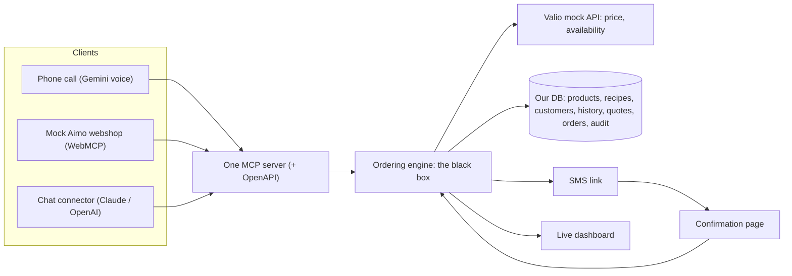

# Vision: Trusted Trade Agents for Valio Aimo

Status: draft v1, 2026-11-14. This file is the source of truth for what we build. Where it disagrees with the GitHub issues, this file wins. Section 13 lists what it changes in issue #1 and what the team still has to agree on.

## 1. One-paragraph vision

We build the **best agentic ordering experience for a food-service wholesaler**: one deterministic ordering engine on the Valio Aimo side, exposed through one open MCP server, that any buyer agent can use to find products, compare offers, turn a recipe into an order and prepare a fixed-price quote. The agent does the work, the engine makes every decision, and a human confirms every order with one tap on a link sent to their phone, with anything unusual pointed out. Phone, browser and chat clients are thin demos on top of the same engine.

## 2. Why this shape

The brief asks how a wholesaler can be "safely and openly readable by autonomous agents" and says it is not about replacing the webshop with a chatbot. After talking with the judges we know a chat client is still needed, because it is the easiest way for them to see the agent infrastructure working. So:

- **The product is the engine and its MCP interface.** That is what Valio Aimo would own.
- **The clients are evidence.** A phone call, a WebMCP-enabled webshop page and a chat connector all hit the same tools and produce the same decisions. That is our openness argument: no client is special.

How this maps to the judging criteria:

| Criterion | Weight | Our answer |
|---|---|---|
| Working end-to-end demo | 30% | Request, lookup, quote, SMS confirmation, order record, all visible live on the dashboard |
| Solving the problem and user need | 20% | Structured matching on claims, units and dates. Recipes become order lines. Few round trips |
| Autonomy and controls | 20% | The agent prepares, the engine decides, a human always confirms. Odd things are flagged. Full audit trail |
| Robustness to exceptions | 15% | Partial stock, unverified stock, missed cutoffs, allergen-safe substitution, never a dead end |
| Openness and path to production | 15% | MCP and OpenAPI, WebMCP, signed quotes, rules as versioned data, stated assumptions and next steps |

## 3. Principles

1. **Deterministic engine, no LLM inside.** Same input and policy version give the same decision and quote hash.
2. **Agents propose, the engine decides, a human confirms.** No agent tool can confirm an order.
3. **Fail closed** on unknown unit and unknown product: stop or ask. A listed `CONTAINS` or `MAY_CONTAIN` for an excluded allergen blocks. A product with no allergen information for it (no listing at all, or `UNDECLARED`) is flagged to the buyer once per order, not blocked.
4. **Never a dead end.** Every "no" comes with a next step: a substitute, another date or a callback request.
5. **Fixed price means fixed.** A signed quote is honoured until it expires.
6. **Explain everything.** Every decision carries reason codes and ready-to-speak text in Finnish and English, built from templates.
7. **Channel-independent.** The channel is logged for traceability but never changes the decision.
8. **Fast.** Few high-level tool calls, cached lookups, answers that can be spoken in one turn.
9. **Open.** Documented standards, rules in plain data files, no vendor lock-in.

## 4. System overview

- **Engine:** pure decision functions (resolve, filter, availability, substitution, price, sanity checks, quote).
- **MCP server:** the only agent-facing surface. WebMCP and the connectors are adapters over the same tools.
- **Confirmation page:** the only place an order can be confirmed. Reached through a unique link.
- **Dashboard:** shows orders live and what happens inside the black box.

## 5. The ordering experience

1. The buyer talks to their agent on any channel: "I need 1,000 litres of lactose-free milk by Monday."
2. The agent sends structured lines to the engine (product attributes, quantity, unit, needed-by date). The engine never sees raw speech.
3. The engine resolves products, applies allergen and diet rules, checks availability and dates, converts units, prices the lines and returns a quote or one short clarification question.
4. The agent reads back the result. On a call it speaks the top pick and at most one alternative.
5. The engine sends an SMS with a unique link to the phone number registered on the customer account. On a phone call the SMS is sent when the call ends.
6. The buyer opens the link, sees the order with odd things pointed out, edits if needed and taps Confirm.
7. The order is stored as an order record and appears on the dashboard. The buyer sees an "order received" page.

Request types in scope:

| Type | Example | Status |
|---|---|---|
| Concrete order | "1,000 L lactose-free milk by Monday" | Core |
| Urgent need | "We ran out of ground beef, 5 kg for tomorrow" | Core. Urgency only limits which products can make the date |
| Usual order | "My usual butter, 20 kg" | Core, from mocked history |
| Recipe to order | "This recipe for 200 people, milk-free" | Core, see section 7 |
| Standing-order drift, proactive selling | | Not built, described as next steps |

## 6. Autonomy and human in the loop

This is the heart of the guardrail story, and it is deliberately simple.

**There is no organisation model.** No mandates, allowed categories, spend caps, approver roles or confirmation tiers. Whoever is identified on the channel is assumed to be allowed to order for their company. The single control is that **every order is confirmed by a human through the SMS link**, which works as a second factor.

| The agent and engine decide alone | A human must decide |
|---|---|
| Which product best matches the request, among deliverable and allergen-safe ones | Confirming the order (always) |
| Ranking by price, stock certainty, history, origin | Choosing between ambiguous matches |
| Rounding up to whole sales units when the overage is small (at most one unit and 2%) | Larger rounding (the buyer is offered an exact-fit product as the alternative, see section 10), or a packaging word that could mean two sizes |
| Swapping to the same product in another pack or a curated substitute, if no allergen is added and the price is within the limit | Any other substitute, brand change, added allergen or price jump |
| Scaling a recipe and subtracting nothing it was not told about | Splitting an order on partial stock |

**Hard stops the human cannot override on the page:** allergen or diet conflict with the kitchen profile, unknown unit conversion, unavailable product, expired or tampered quote.

### The confirmation link and page

- The SMS goes to the identified person's own registered number. An agent can never choose or change the recipient. (In production an account could name a separate confirmation person. We do not build that.)
- The link carries a random single-use token (128 bits or more, stored hashed), bound to the quote, its hash and the recipient. It expires with the quote (default 30 minutes).
- The page is server-rendered from engine data only. It shows lines, quantities in sales units and in the unit the buyer asked for, delivery date, gross total and a readable trace of why each product was chosen.
- **Asked and added, side by side.** Each line shows what we understood the buyer asked for ("1,000 L lactose-free milk, by Monday") next to the product we added for it (name, pack, quantity, price), with a one-line reason for the choice ("cheapest lactose-free milk in stock that arrives Monday"). If one request became several lines (a recipe, or a split on partial stock), they are grouped under that request. A misheard or misunderstood request is then easy to spot, and the buyer sees why each product was chosen.
- **Odd things are shown first, in plain words.** Each one must be acknowledged before Confirm is enabled. Examples:
  - "5,000 pieces. You usually order 5 to 50." (quantity outside the normal range, likely unit or scanning error)
  - "This is a substitute for X. It also contains soy."
  - "Rounded up from 1,000 L to 1,002 L (334 cases)."
  - "Stock is not confirmed for this product."
  - "No allergen information is listed for these products: ..." (one notice for the whole order)
  - "You have not ordered this product before."
  - "Same order was placed 20 minutes ago."
  - "Pack size was read from the product name."
- The buyer can edit: change a quantity, remove a line or pick an offered alternative. Every edit runs through the engine again and produces a new quote on the same page. The old quote is void.
- Confirm creates the order record. Cancel voids the quote. If the SMS cannot be delivered, nothing is ordered and the agent offers a resend.

Sanity checks ("does this make sense?") come from the customer's order history: a normal range per product, duplicates within two hours and new products. They never block on their own. They decide what gets highlighted and needs an explicit acknowledgement.

**Path to production:** confirmation policy is one config value, today `always`. Spend thresholds, per-company mandates and separate approvers can be added later as policy data without changing the engine or the interface.

## 7. Recipes

Recipes are needed for the "need, recipe, order" scenario and for adapting a menu to any allergen or diet (milk-free is only one example). They are what makes this more than product search.

- The recipes are already in the repo: `data/valio-recipes.json` holds 2,091 recipes scraped once from the Minun Aimo portal (name, default portions, ingredients with per-portion amounts, diet tags such as lactose-free and milk-free, nutrition). No live scraping during a request. Juho owns the scraping and the linking to product ids.
- Storage is one Postgres instance with two kinds of data: normal tables for product data, and a vector index (pgvector) for recipes and other similarity search. We add more vector indexes if we need a different kind of comparison or other data than recipes.
- `data/recipe-product-map.json` links the 266 branded recipe products to Aimo product codes with pack sizes. About a quarter of ingredient rows (5,456 of 21,650) carry such a product link. The rest are generic names ("kypsää perunasuikaletta") and go through normal product resolution.
- The MCP exposes all of them: search recipes by ingredient, diet, occasion or a free description, and get a recipe scaled to a portion count. With 2,091 recipes, search needs proper retrieval (text plus the vector index over names, descriptions, ingredients and tags), not only keyword match. Retrieval only finds recipes. It never takes part in an order decision.
- A recipe becomes order lines in two steps. The agent (LLM) may propose and adapt recipes. The engine does the arithmetic: scale, convert to sales units, apply the kitchen's allergen and diet rules strictly, and resolve each ingredient to a product. Every excluded allergen or diet rule, whichever it is, is a hard filter on every ingredient and every substitute.
- An ingredient that cannot be resolved safely is returned as a clarification, not guessed.

- The recipe's own diet tags are a hint for search only. Safety is always decided from the allergen data of the products actually chosen.

## 8. Agent interface

One MCP server over Streamable HTTP, with the same operations documented as OpenAPI. Tools are high-level so a voice agent needs few calls.

| Tool | Purpose |
|---|---|
| `search_products` | Structured search: text, claims (lactose-free, gluten-free, vegan), category, unit, needed-by. Returns a shortlist with price and availability |
| `get_customer_context` | The kitchen profile and usual items, so "my usual" works |
| `search_recipes`, `get_recipe` | Find a recipe and scale it to portions |
| `build_quote` | The main call. Takes all lines at once, returns a decision, priced lines, flags, alternatives and text to speak |
| `update_quote` | Answer a clarification or change lines. Returns a new quote |
| `request_confirmation` | Sends the SMS link for a quote. No recipient argument |
| `get_order_status` | Pending confirmation, confirmed, cancelled, expired |

Decisions returned by `build_quote`: `ready` (quote can be sent for confirmation), `needs_clarification` (one question, answerable in one turn), `rejected` (with a reason and a next step). Responses carry real sentences in Finnish and English, not only codes. For a decision that cannot be overridden the agent says so and moves on.

Not available to any agent: confirm, cancel on the buyer's behalf, read the audit log, change customer data.

Everything from an agent or a product record is data, not instructions: strict schemas, unknown fields rejected, free text never used in decisions and escaped when shown.

## 9. Channels and identity

One engine, no per-channel limits. Identification only tells us which customer account the request belongs to. The SMS link is the real authorisation.

| Channel | Client | Identified by | Role in the demo |
|---|---|---|---|
| Phone | Web "virtual phone" page, Gemini voice, MCP | Caller's number matches the customer account (in the demo: the number the visitor types in) | Main stage demo |
| Browser | Mock Aimo webshop page registering the tools through WebMCP | Logged-in webshop session | Shown working with an OpenAI client |
| Chat connector | Claude connector first, then an OpenAI connector or similar, on the remote MCP | Email and password login | For judges and peers to try themselves |

- Unknown phone number: the agent says so and ends the call, optionally sending account activation instructions to that number.
- All channels must work end to end, because other people will test them.

### Phone: real flow and demo flow

**Real flow.** Only a number that belongs to a customer account can order by phone. The caller is identified by that number, and the confirmation link goes to the account's configured confirmation person, or to the caller if the account has none. Caller id only identifies. The link is what authorises.

**Demo flow.** Everyone "has an account", so anyone at the booth can try it:

1. The visitor opens our demo website and enters their own phone number. We create a demo account for that number on the spot, with a default kitchen profile and seeded order history.
2. The page turns into a phone-style call screen (dial pad look, call timer, mute and hang-up) and connects to our server over the web. The audio runs through the browser to the Gemini voice agent. No real phone call is placed.
3. The visitor talks to the agent and makes an order, holding their own phone to their ear like a normal call.
4. When the call ends, the confirmation SMS goes to the number they entered, and they confirm on the same phone.

The number they type is the only thing that differs from the real flow: it stands in for the caller id and the account lookup. Everything after that is the real path.

The call screen does not dim when held to the ear. Browsers do not give web pages reliable access to the proximity sensor, so we leave it out.

## 10. Data and Valio API rules

Details are in `valio-api-analysis.md`. Facts confirmed by the Valio mentors on 2026-11-14:

| Topic | Rule |
|---|---|
| Orders | There is no order API and the webshop is production. Producing an order for human approval is enough. Orders live in our own database |
| `closingTime` | It is the order cutoff for `availableDate`. We enforce it |
| Mock data | Frozen for the weekend. In real life dates would shift. The engine takes "now" from an injectable clock, and the demo clock is set before the cutoffs (Thu 2026-11-12 09:00) |
| Availability of 999999 or more | Stock is unknown and any quantity can be ordered (typically terminal products Aimo does not stock). We allow the order and flag it as unverified |
| Empty availability | Not available |
| `allowedLotSize` 0.01 | Treat as 1. Orders are whole sales units |
| Rate limits | A few hundred calls per minute is fine, bursts above roughly 10 per second are not (our reading of the mentor's note). A 429 blocks us for 30 seconds, so the client must back off and retry after that |

Our own rules on top:

- Product search runs locally on the static product file loaded into Postgres. Price and availability are called only for a shortlist and cached for about five minutes.
- Sales unit comes from the availability response and is cross-checked against `units[]` and the price ratio. Disagreement means `UNIT_UNKNOWN`.
- Quotes are gross (VAT included), in integer cents, decimal arithmetic. Deposits are not added. Payment is by invoice and out of scope.
- Allergen codes in the product file are the GS1 `AllergenTypeCode` vocabulary. We use the mapping in `data/gs1_allergen_codes.csv` (code, GS1 label, the matching EU 1169/2011 allergen). The same filter applies to every substitute.
  - Allergens are checked per product, from its own listing only. We never infer allergens, or their absence, from the category.
  - About 30% of food products have no allergen listing at all, and some list an allergen as `UNDECLARED`. Both are orderable but flagged: the buyer gets one notice per order, after all lines are added and before confirmation, and the confirmation page lists them as flagged items. Having a listing or not is not a ranking factor.
  - "Nut-free" is a set of codes, not one: `AN` plus the specific nuts (`SA`, `SH`, `SW`, `SC`, `SP`, `SM`, `SR`, `ST`). Whether pine nut, coconut and peanut count, and whether lactose (`ML`) counts for milk-free, is decided in issue #6.
  - `X99` means no obligatory allergens are present. It never triggers a block.
  - Lactose-free uses code `ML` together with the `LACTOSE` free-from claim.
- **Food waste.** Rounding up is allowed, but when it would leave a real surplus the engine also looks for a similar product that fits the needed amount exactly and offers it. Example for a 10 L need: "12 L of Valio (4 x 3 L) or 10 L of another milk?"
- Availability is rechecked at confirmation. If it got worse the quote is void and a new one is offered.
- The engine can run against the live API or a recorded snapshot, with a switch.
- Customers, kitchen profiles (allergen and diet exclusions), phone numbers and order history are mocked by us. No real people.

## 11. Audit, traceability and dashboard

- Every engine step writes an append-only, hash-chained event: request, candidates considered, filters applied, choice and reason codes, quote, SMS sent, confirmation.
- **Buyer view:** on the confirmation page and afterwards, a readable trace from "what you asked" to "what was chosen and why".
- **Aimo operator view (dashboard):** all orders live, grouped by buyer company. Each order opens into the black box: the steps, rejected candidates, flags and confirmation state. Buyers see only their own company's orders.
- The dashboard reads from its own status stream, pushed live. It shows failures too: rejected, link expired, SMS failed, callback requested.
- It must be readable from a distance: plain-language steps, not raw JSON.

## 12. Open standards and path to production

What we actually implement, and what we only point to. We say which is which in the pitch.

| Area | Built this weekend | Production path |
|---|---|---|
| Agent interface | MCP (Streamable HTTP) plus OpenAPI, WebMCP adapter | Discovery documents (A2A agent card) so agents can find the interface |
| Identity | Session, phone number match, email and password | OAuth 2.1 with token exchange (RFC 8693) to separate buyer and agent, limits as RFC 9396 authorisation details |
| Human sign-off | SMS link bound to the quote hash | Same pattern as OpenID CIBA: out-of-band approval of an exact payload |
| Trust in claims | Quote signed with a published key (JWS), each claim labelled: stock verified or unverified, price from API, origin from product data | Verifiable credentials for quotes and origin claims |
| Order output | Order record in our database | Peppol BIS Ordering 3.0 (UBL) export into Aimo's ordering systems |
| Product data | Synkka-based product file, GTINs, allergens as GS1 AllergenTypeCode mapped to the 14 EU 1169/2011 allergens | Live GS1 product data feed |
| Audit | Hash-chained events | OpenTelemetry traces |

Payment standards (x402 and similar) do not fit invoice-based B2B wholesale and are out of scope.

## 13. Scope

**Must work (P0):** engine core (resolve, allergen filter, availability and dates, units, price, quote), a basic substitution ladder that always returns something, MCP server, WebMCP on the mock webshop, SMS link and confirmation page with flags and editing, order record, phone demo, live dashboard, audit events.

**Should work (P1):** better substitution ranking (hand-tuned profiles, exact-fit options), sanity checks from history, recipes through the MCP, chat connector with login.

**Stretch:** an A2UI agent embedded in the mock Aimo page and on the confirmation page so the buyer can ask for changes in words, Peppol order export, payment, carbon and reliability ranking, discovery documents.

**Not building:** a marketplace, negotiation, customer-specific pricing, real order placement, organisation hierarchies and approval chains.

### What this changes in issue #1

- Mandates, allowed categories, caps, approver roles and tiers C0 to C3 are dropped. One confirmation step replaces them. Tests T02 to T07, T30 to T33 and T43 to T48 no longer apply as written.
- The decision `needs_approval` is gone. Anomaly flags no longer route to an approver, they are highlighted on the confirmation page.
- Chat and other channels are back in scope. The demo is not voice only.
- The confirmation page is editable and shows the decision trace.
- Recipes are in scope through the MCP.
- Missing allergen data no longer blocks. A product with no allergen listing is flagged once per order (T23 changes).
- Availability of 999999 or more is "unknown but orderable", including for Stock products (issue #5 treated the Stock sentinel as confirmed unlimited).

### Decided on 2026-11-14

1. The organisation model is dropped completely. In what we build, the confirmation link goes to the identified person's own number. A separate confirmation person per account is a production option only.
2. Flagged items need an explicit acknowledgement on the page before Confirm is enabled.
3. OpenAI clients use WebMCP. For connectors we build the Claude connector first, then an OpenAI connector or similar.
4. All recipes are searchable, not a hand-picked set.

### Still open

1. What kitchen profile and order history a demo account gets. We answer this once we have some data and have used the product ourselves.
